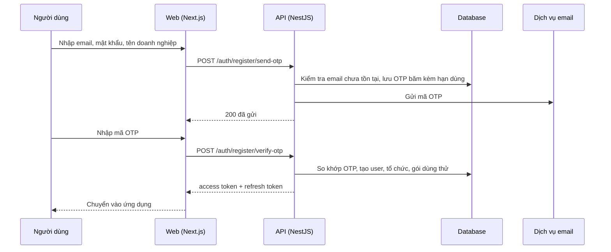

# F01: Đăng ký tài khoản (OTP email)

- **Nhóm:** A. Tài khoản và gói
- **Mức ưu tiên:** P0
- **Route giao diện:** `/register`
- **API chính:**
  - `POST /auth/register/send-otp`
  - `POST /auth/register/resend-otp`
  - `POST /auth/register/verify-otp`
  - `POST /auth/register`

## Điều kiện trước khi test

- Email chưa đăng ký
- Dịch vụ gửi email hoạt động (hoặc môi trường test có hộp thư giả)

## Sơ đồ sequence

## Các bước test

| # | Bước thực hiện | Kết quả mong đợi | Test tự động |
|---|---|---|---|
| 1 | Mở /register, nhập email hợp lệ và mật khẩu đủ mạnh | Gửi OTP thành công, hiện ô nhập mã | `test-auth-registration-otp.ts` |
| 2 | Nhập đúng OTP | Tạo tài khoản, tổ chức, tự đăng nhập | `test-auth-registration-otp.ts` |
| 3 | Nhập sai OTP | Báo lỗi, không tạo tài khoản | `test-auth-registration-otp.ts` |
| 4 | Nhập OTP hết hạn hoặc đã dùng | Bị từ chối | `test-auth-registration-otp.ts` |
| 5 | Bấm gửi lại OTP liên tục | Bị giới hạn tần suất | `test-login-rate-limit.ts` |
| 6 | Đăng ký bằng email đã tồn tại | Báo email đã dùng, không lộ thông tin nhạy cảm | Thủ công |
| 7 | Kiểm tra nhãn tiếng Việt và bố cục trên mobile | Không vỡ giao diện | Thủ công |

## Trường hợp biên và lỗi cần thử

- Mật khẩu yếu hoặc thiếu trường bắt buộc
- Mất mạng giữa chừng khi xác minh OTP
- Tài khoản mới có đúng tổ chức, gói dùng thử và credit khởi tạo

## Ghi chú

- Cột "Thủ công" nghĩa là chưa thấy test tự động tương ứng. Cần kiểm tra bằng tay hoặc viết test mới.
- Việc ghép test với bước dựa trên tên file, chưa mở đọc từng test. Chưa chạy lại để lấy baseline.
- Test có hậu tố `-live` hoặc `-e2e` gọi dịch vụ ngoài, chỉ chạy khi chủ động.
- Cách chạy và ma trận: `docs/test case/REGRESSION_MATRIX.md`.
