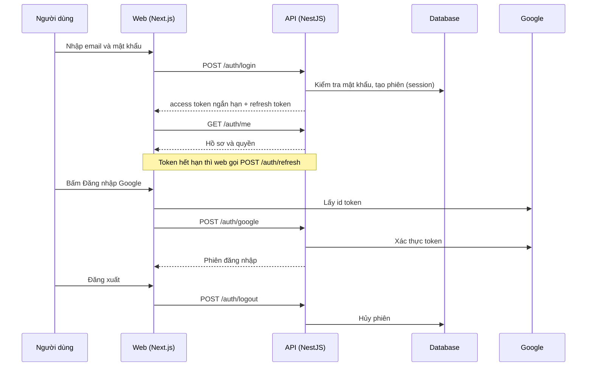

# F02: Đăng nhập, Google, làm mới phiên, đăng xuất

- **Nhóm:** A. Tài khoản và gói
- **Mức ưu tiên:** P0
- **Route giao diện:** `/login`
- **API chính:**
  - `POST /auth/login`
  - `POST /auth/google`
  - `POST /auth/refresh`
  - `POST /auth/logout`
  - `POST /auth/logout-all`
  - `POST /auth/forgot-password`
  - `POST /auth/reset-password`
  - `GET /auth/me`

## Điều kiện trước khi test

- Có tài khoản test
- Biến NEXT_PUBLIC_GOOGLE_CLIENT_ID đã được build vào web

## Sơ đồ sequence

## Các bước test

| # | Bước thực hiện | Kết quả mong đợi | Test tự động |
|---|---|---|---|
| 1 | Đăng nhập email và mật khẩu đúng | Vào ứng dụng, /auth/me trả đúng hồ sơ | Thủ công |
| 2 | Đăng nhập sai mật khẩu nhiều lần | Bị giới hạn/khóa tạm | `test-login-rate-limit.ts` |
| 3 | Bấm đăng nhập Google | Không hiện lỗi thiếu Client ID, tạo hoặc ghép đúng tài khoản | `test-auth-google.ts` |
| 4 | Để token hết hạn rồi thao tác | Tự làm mới phiên, không bị đẩy ra màn đăng nhập | Thủ công |
| 5 | Đăng xuất một thiết bị và đăng xuất tất cả | Phiên bị hủy, refresh token không dùng lại được | Thủ công |
| 6 | Quên mật khẩu rồi đặt lại | Mật khẩu mới dùng được, mật khẩu cũ không còn | Thủ công |
| 7 | Mở trang cần đăng nhập khi chưa đăng nhập | Chuyển về /login | Thủ công |

## Trường hợp biên và lỗi cần thử

- Tài khoản bị khóa hoặc tổ chức bị tạm ngưng
- Dùng refresh token cũ sau khi đổi mật khẩu
- Sau mỗi lần build web: kiểm tra nút Google

## Ghi chú

- Cột "Thủ công" nghĩa là chưa thấy test tự động tương ứng. Cần kiểm tra bằng tay hoặc viết test mới.
- Việc ghép test với bước dựa trên tên file, chưa mở đọc từng test. Chưa chạy lại để lấy baseline.
- Test có hậu tố `-live` hoặc `-e2e` gọi dịch vụ ngoài, chỉ chạy khi chủ động.
- Cách chạy và ma trận: `docs/test case/REGRESSION_MATRIX.md`.
