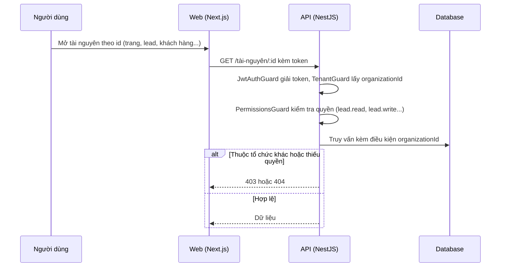

# F03: Phân quyền và tách dữ liệu giữa các tổ chức

- **Nhóm:** A. Tài khoản và gói
- **Mức ưu tiên:** P0
- **Route giao diện:** `Mọi route`
- **API chính:**
  - `Guard: JwtAuthGuard, TenantGuard, PermissionsGuard, PlatformAdminGuard`

## Điều kiện trước khi test

- Hai tổ chức A và B với dữ liệu riêng
- Tài khoản vai trò khác nhau (quản trị, nhân viên, SUPER_ADMIN)

## Sơ đồ sequence

## Các bước test

| # | Bước thực hiện | Kết quả mong đợi | Test tự động |
|---|---|---|---|
| 1 | Người dùng tổ chức A gọi id tài nguyên của tổ chức B | 403 hoặc 404, không lộ dữ liệu | `test-p0-security.ts` |
| 2 | Kiểm tra tách dữ liệu Landing Page giữa tổ chức | Không thấy trang, lead, mẫu riêng của tổ chức khác | `test-landing-page-tenant-isolation.cjs` |
| 3 | Người không phải SUPER_ADMIN gọi endpoint admin | Bị chặn | `test-platform-admin-rbac.ts` |
| 4 | Quyền theo vai trò trong quản lý công việc | Chỉ làm được việc đúng quyền | `test-work-management-rbac.ts` |
| 5 | Phiên trợ lý AI giữa hai tổ chức | Không lộ lịch sử chéo | `test-assistant-session-tenant.ts` |
| 6 | Upload file không hợp lệ hoặc quá lớn | Bị từ chối | `test-upload-security-e2e.cjs` |
| 7 | Kiểm tra mã hóa dữ liệu nhạy cảm | Giải mã đúng, sai khóa thì lỗi | `test-encryption-aes-gcm.ts` |
| 8 | Các lớp bảo mật giai đoạn 1 đến 3 | Không phát sinh lỗ hổng cũ | `test-wave1-security.ts` |

## Trường hợp biên và lỗi cần thử

- Id đúng nhưng organizationId sai
- Quyền bị thu hồi khi phiên còn hiệu lực
- Endpoint công khai không được lộ dữ liệu nội bộ

## Ghi chú

- Cột "Thủ công" nghĩa là chưa thấy test tự động tương ứng. Cần kiểm tra bằng tay hoặc viết test mới.
- Việc ghép test với bước dựa trên tên file, chưa mở đọc từng test. Chưa chạy lại để lấy baseline.
- Test có hậu tố `-live` hoặc `-e2e` gọi dịch vụ ngoài, chỉ chạy khi chủ động.
- Cách chạy và ma trận: `docs/test case/REGRESSION_MATRIX.md`.
