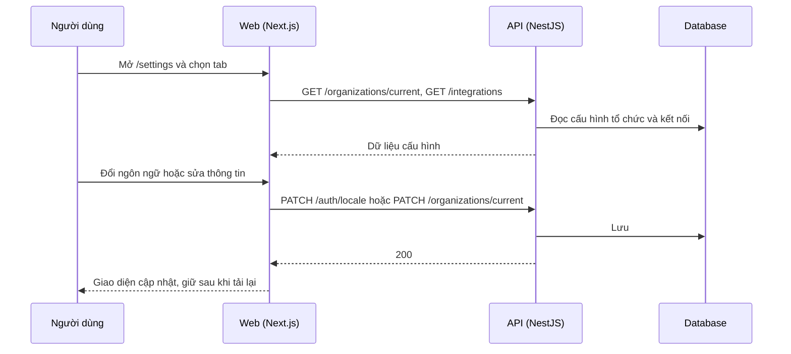

# F04: Cài đặt (tài khoản, ngôn ngữ, kiến thức, kết nối, API, hệ thống)

- **Nhóm:** A. Tài khoản và gói
- **Mức ưu tiên:** P1
- **Route giao diện:** `/settings?tab=account|language|knowledge|connections|api|system`
- **API chính:**
  - `PATCH /auth/locale`
  - `GET /organizations/current`
  - `PATCH /organizations/current`
  - `GET /integrations`
  - `POST /integrations/:provider/connect`
  - `DELETE /integrations/:provider`
  - `POST /auth/change-password`

## Điều kiện trước khi test

- Đã đăng nhập

## Sơ đồ sequence

## Các bước test

| # | Bước thực hiện | Kết quả mong đợi | Test tự động |
|---|---|---|---|
| 1 | Đổi ngôn ngữ giao diện rồi tải lại trang | Giữ lựa chọn ngôn ngữ | `test-ui-locale-persist.ts` |
| 2 | Sửa thông tin tổ chức | Lưu thành công, hiển thị đúng | Thủ công |
| 3 | Đổi mật khẩu | Mật khẩu mới dùng được, phiên cũ xử lý đúng | Thủ công |
| 4 | Thêm và xóa khóa API | Khóa mới hoạt động, khóa bị xóa không dùng được | Thủ công |
| 5 | Kết nối và ngắt dịch vụ bên ngoài | Trạng thái kết nối đúng (xem F22, F25, F32) | Thủ công |
| 6 | Mở từng tab cài đặt | Không lỗi, nhãn đúng | Thủ công |

## Trường hợp biên và lỗi cần thử

- Người không có quyền thấy tab hạn chế
- Mất mạng khi lưu
- Cài đặt tab Kiến thức liên quan F11

## Ghi chú

- Cột "Thủ công" nghĩa là chưa thấy test tự động tương ứng. Cần kiểm tra bằng tay hoặc viết test mới.
- Việc ghép test với bước dựa trên tên file, chưa mở đọc từng test. Chưa chạy lại để lấy baseline.
- Test có hậu tố `-live` hoặc `-e2e` gọi dịch vụ ngoài, chỉ chạy khi chủ động.
- Cách chạy và ma trận: `docs/test case/REGRESSION_MATRIX.md`.
