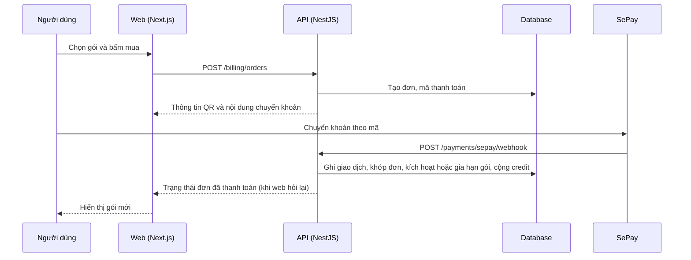

# F05: Gói dịch vụ, dùng thử và thanh toán

- **Nhóm:** A. Tài khoản và gói
- **Mức ưu tiên:** P0
- **Route giao diện:** `/pricing, /finance-billing`
- **API chính:**
  - `GET /billing/plans`
  - `GET /billing/subscription`
  - `GET /billing/trial/status`
  - `POST /billing/trial/activate`
  - `POST /billing/orders`
  - `POST /billing/credit-orders`
  - `POST /payments/sepay/webhook`

## Điều kiện trước khi test

- Tài khoản mới (dùng thử) và tài khoản có gói trả phí
- Cấu hình SePay (môi trường thử)

## Sơ đồ sequence

## Các bước test

| # | Bước thực hiện | Kết quả mong đợi | Test tự động |
|---|---|---|---|
| 1 | Xem danh sách gói và gói hiện tại | Đúng gói, ngày hết hạn | `test-subscription-display.cjs` |
| 2 | Kiểm tra trạng thái tài khoản theo gói | Đúng trạng thái | `test-account-subscription-status.ts` |
| 3 | Kích hoạt dùng thử 3 ngày | Cấp đúng quyền và hết hạn đúng hạn | `test-trial-3d.ts` |
| 4 | Dùng tính năng ngoài gói hoặc hết hạn | Bị chặn kèm hướng dẫn nâng cấp | `test-subscription-gate.ts` |
| 5 | Tạo đơn và thanh toán qua QR | Webhook ghi nhận đúng, không ghi trùng | `test-sepay-billing.ts` |
| 6 | Kiểm tra QR và giá | Đúng số tiền và nội dung | `test-msp-pricing-qr.ts` |
| 7 | Mua gói và nhận credit | Cấp đúng số credit | `test-subscription-auto-credit.ts` |
| 8 | Hủy đơn chưa thanh toán | Đơn chuyển trạng thái hủy | Thủ công |

## Trường hợp biên và lỗi cần thử

- Webhook gửi lặp hoặc đến trước khi đơn tạo xong
- Chuyển khoản sai số tiền hoặc sai nội dung
- Gia hạn khi gói còn hạn (cộng dồn thời gian)

## Ghi chú

- Cột "Thủ công" nghĩa là chưa thấy test tự động tương ứng. Cần kiểm tra bằng tay hoặc viết test mới.
- Việc ghép test với bước dựa trên tên file, chưa mở đọc từng test. Chưa chạy lại để lấy baseline.
- Test có hậu tố `-live` hoặc `-e2e` gọi dịch vụ ngoài, chỉ chạy khi chủ động.
- Cách chạy và ma trận: `docs/test case/REGRESSION_MATRIX.md`.
