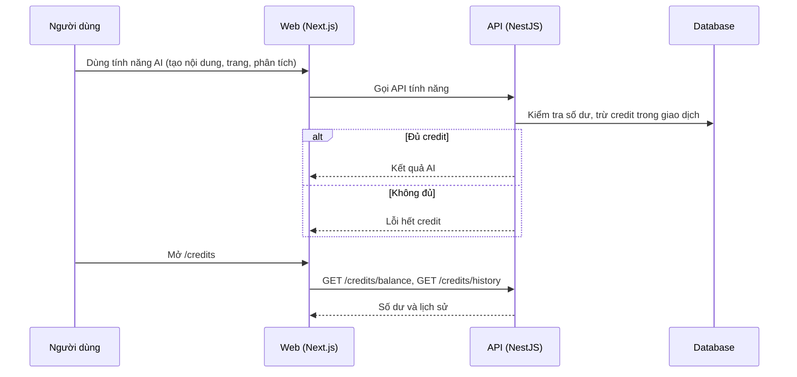

# F06: Credit AI (số dư, trừ credit, nạp)

- **Nhóm:** A. Tài khoản và gói
- **Mức ưu tiên:** P0
- **Route giao diện:** `/credits`
- **API chính:**
  - `GET /credits/balance`
  - `GET /credits/packages`
  - `GET /credits/history`
  - `POST /billing/credit-orders`

## Điều kiện trước khi test

- Tài khoản có số dư credit xác định

## Sơ đồ sequence

## Các bước test

| # | Bước thực hiện | Kết quả mong đợi | Test tự động |
|---|---|---|---|
| 1 | Dùng tính năng AI khi đủ credit | Trừ đúng số credit, có dòng lịch sử | `test-credit-service.ts` |
| 2 | Dùng khi hết credit | Bị chặn, số dư không âm | `test-credit-regression.ts` |
| 3 | Mở trang credit | Số dư và lịch sử khớp dữ liệu | `test-credit-ui.ts` |
| 4 | Admin tặng credit | Cộng đúng, có nhật ký | `test-admin-gift-credit.ts` |
| 5 | Mua gói credit | Cộng sau khi thanh toán thành công (xem F05) | Thủ công |
| 6 | Hai yêu cầu AI cùng lúc khi gần hết credit | Không bị trừ vượt số dư | Thủ công |

## Trường hợp biên và lỗi cần thử

- Tính năng AI thất bại giữa chừng (hoàn credit hay không)
- Làm tròn số credit
- Hết hạn credit nếu có

## Ghi chú

- Cột "Thủ công" nghĩa là chưa thấy test tự động tương ứng. Cần kiểm tra bằng tay hoặc viết test mới.
- Việc ghép test với bước dựa trên tên file, chưa mở đọc từng test. Chưa chạy lại để lấy baseline.
- Test có hậu tố `-live` hoặc `-e2e` gọi dịch vụ ngoài, chỉ chạy khi chủ động.
- Cách chạy và ma trận: `docs/test case/REGRESSION_MATRIX.md`.
