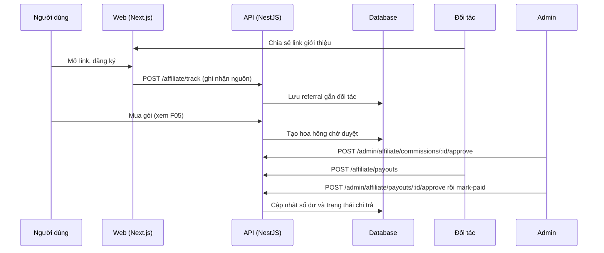

# F07: Chương trình affiliate

- **Nhóm:** A. Tài khoản và gói
- **Mức ưu tiên:** P1
- **Route giao diện:** `/affiliate, /admin/affiliate`
- **API chính:**
  - `POST /affiliate/track`
  - `GET /affiliate/me`
  - `GET /affiliate/referrals`
  - `GET /affiliate/commissions`
  - `POST /affiliate/payout-method`
  - `POST /affiliate/payouts`
  - `GET /admin/affiliate/*`
  - `POST /admin/affiliate/commissions/:id/approve`
  - `POST /admin/affiliate/payouts/:id/mark-paid`

## Điều kiện trước khi test

- Một đối tác affiliate có mã giới hạn
- Tài khoản SUPER_ADMIN

## Sơ đồ sequence

## Các bước test

| # | Bước thực hiện | Kết quả mong đợi | Test tự động |
|---|---|---|---|
| 1 | Đăng ký qua link giới thiệu | Ghi nhận đúng đối tác trong thống kê | `test-affiliate-signup-stats.ts` |
| 2 | Kiểm tra thống kê affiliate | Số liệu lượt giới thiệu, đăng ký khớp | `test-affiliate.ts` |
| 3 | Hiển thị giao diện affiliate | Số liệu hiển thị đúng | `test-affiliate-ui-logic.ts` |
| 4 | Mua gói bởi người được giới thiệu | Phát sinh hoa hồng đúng tỷ lệ | Thủ công |
| 5 | Admin duyệt hoặc đảo hoa hồng | Số dư đối tác đổi đúng | Thủ công |
| 6 | Tạo yêu cầu rút tiền và admin xử lý | Trạng thái đúng, không rút vượt số dư | Thủ công |
| 7 | Phát hiện gian lận (tự giới thiệu, trùng) | Bị gắn cờ trong mục fraud | Thủ công |

## Trường hợp biên và lỗi cần thử

- Đối tác tự giới thiệu chính mình
- Hoàn tiền đơn đã phát sinh hoa hồng
- Thay đổi tỷ lệ hoa hồng giữa chừng

## Ghi chú

- Cột "Thủ công" nghĩa là chưa thấy test tự động tương ứng. Cần kiểm tra bằng tay hoặc viết test mới.
- Việc ghép test với bước dựa trên tên file, chưa mở đọc từng test. Chưa chạy lại để lấy baseline.
- Test có hậu tố `-live` hoặc `-e2e` gọi dịch vụ ngoài, chỉ chạy khi chủ động.
- Cách chạy và ma trận: `docs/test case/REGRESSION_MATRIX.md`.
