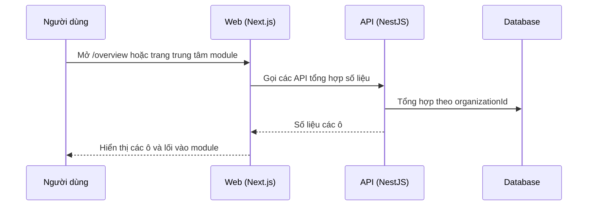

# F08: Tổng quan và trung tâm module

- **Nhóm:** B. Tổng quan và AI
- **Mức ưu tiên:** P2
- **Route giao diện:** `/overview, /crm, /advertising, /messaging, /hrm, /sales, /finance-billing`
- **API chính:**
  - `GET /marketing/reports`
  - `GET /leads/funnel/stats`

## Điều kiện trước khi test

- Tổ chức có dữ liệu mẫu

## Sơ đồ sequence

## Các bước test

| # | Bước thực hiện | Kết quả mong đợi | Test tự động |
|---|---|---|---|
| 1 | Mở trang tổng quan | Các ô số liệu hiển thị đúng | `test-module-overview-boxes.ts` |
| 2 | Mở từng nhóm menu | Mọi tab còn hoạt động, không mất sau khi sửa menu | `test-all-sidebar-tabs-restore.ts` |
| 3 | Thu gọn và mở rộng sidebar | Trạng thái đúng | `test-main-app-sidebar-collapse.cjs` |
| 4 | Kiểm tra điều hướng sau nâng cấp | Không thiếu mục | `test-sidebar-upgrade-nav.cjs` |
| 5 | Hồi quy giao diện chung | Không vỡ bố cục | `test-ui-regression-restore.ts` |
| 6 | Tài khoản thường và SUPER_ADMIN | Mục admin chỉ hiện cho SUPER_ADMIN | Thủ công |

## Trường hợp biên và lỗi cần thử

- Tổ chức chưa có dữ liệu (trạng thái trống)
- Màn hình nhỏ

## Ghi chú

- Cột "Thủ công" nghĩa là chưa thấy test tự động tương ứng. Cần kiểm tra bằng tay hoặc viết test mới.
- Việc ghép test với bước dựa trên tên file, chưa mở đọc từng test. Chưa chạy lại để lấy baseline.
- Test có hậu tố `-live` hoặc `-e2e` gọi dịch vụ ngoài, chỉ chạy khi chủ động.
- Cách chạy và ma trận: `docs/test case/REGRESSION_MATRIX.md`.
