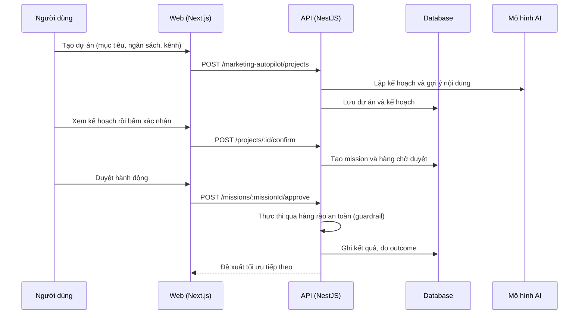

# F09: Marketing Autopilot

- **Nhóm:** B. Tổng quan và AI
- **Mức ưu tiên:** P1
- **Route giao diện:** `/marketing-autopilot`
- **API chính:**
  - `GET /marketing-autopilot/context`
  - `POST /marketing-autopilot/autofill`
  - `POST /marketing-autopilot/projects`
  - `GET /marketing-autopilot/projects/:id/plan`
  - `POST /marketing-autopilot/projects/:id/confirm`
  - `POST /marketing-autopilot/missions/:missionId/approve`
  - `GET /marketing-autopilot/missions/:missionId/outcome-loop`
  - `POST /marketing-autopilot/optimization-proposals/:proposalId/approve`

## Điều kiện trước khi test

- Có hồ sơ doanh nghiệp
- Đủ credit AI

## Sơ đồ sequence

## Các bước test

| # | Bước thực hiện | Kết quả mong đợi | Test tự động |
|---|---|---|---|
| 1 | Tạo, sửa, xóa dự án và lọc danh sách | Danh sách đúng | `test-marketing-autopilot-project-crud.ts` |
| 2 | Kiểm tra bộ lọc danh sách dự án | Lọc đúng | `test-marketing-autopilot-project-list-filters.ts` |
| 3 | Tự điền form và gợi ý đối tượng | Gợi ý hợp lý | `test-marketing-autopilot-ai-audience.ts` |
| 4 | Lập kế hoạch bằng AI | Kế hoạch có cấu trúc đúng | `test-marketing-autopilot-llm-planner.ts` |
| 5 | Tạo nháp nội dung từ kế hoạch | Nháp lưu được | `test-marketing-autopilot-content-draft.ts` |
| 6 | Duyệt hành động | Chỉ thực thi sau khi duyệt | `test-marketing-autopilot-approval-e2e.ts` |
| 7 | Thực thi và hàng rào an toàn | Chặn hành động vượt ngân sách hoặc rủi ro | `test-marketing-autopilot-execution-guardrail-e2e.ts` |
| 8 | Vòng kết quả và học từ kết quả | Đo và đề xuất tối ưu đúng | `test-marketing-autopilot-outcome-loop-e2e.ts` |
| 9 | Mô phỏng ngân sách | Số liệu hợp lý | `test-marketing-autopilot-budget-sim.ts` |

## Trường hợp biên và lỗi cần thử

- Hết credit giữa chừng
- AI trả dữ liệu sai cấu trúc
- Mission bị tạm dừng rồi tiếp tục

## Ghi chú

- Cột "Thủ công" nghĩa là chưa thấy test tự động tương ứng. Cần kiểm tra bằng tay hoặc viết test mới.
- Việc ghép test với bước dựa trên tên file, chưa mở đọc từng test. Chưa chạy lại để lấy baseline.
- Test có hậu tố `-live` hoặc `-e2e` gọi dịch vụ ngoài, chỉ chạy khi chủ động.
- Cách chạy và ma trận: `docs/test case/REGRESSION_MATRIX.md`.
