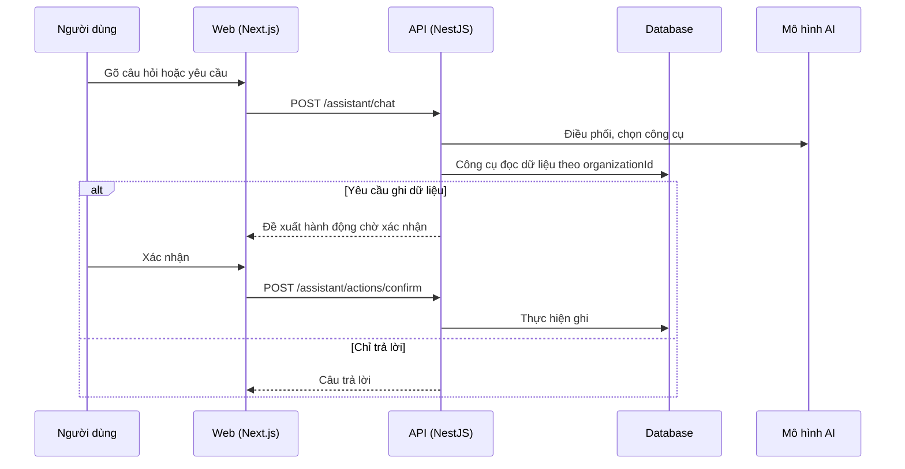

# F10: Trợ lý AI (chat, công cụ, hành động ghi dữ liệu)

- **Nhóm:** B. Tổng quan và AI
- **Mức ưu tiên:** P1
- **Route giao diện:** `Widget trợ lý toàn ứng dụng`
- **API chính:**
  - `POST /assistant/chat`
  - `GET /assistant/tools`
  - `GET /assistant/sessions`
  - `POST /assistant/actions/confirm`
  - `POST /assistant/actions/cancel`

## Điều kiện trước khi test

- Đã đăng nhập
- Đủ credit nếu tính phí

## Sơ đồ sequence

## Các bước test

| # | Bước thực hiện | Kết quả mong đợi | Test tự động |
|---|---|---|---|
| 1 | Hỏi về dữ liệu (lead, doanh số) | Trả đúng, chỉ dữ liệu của tổ chức | `test-assistant-domain-tools.ts` |
| 2 | Điều phối chọn đúng công cụ | Công cụ phù hợp được gọi | `test-assistant-orchestrator.ts` |
| 3 | Yêu cầu tạo hoặc sửa dữ liệu | Hiện bước xác nhận trước khi ghi | `test-assistant-write-flow.ts` |
| 4 | Hủy hành động chờ xác nhận | Không ghi gì | `test-assistant-write.ts` |
| 5 | Yêu cầu báo cáo | Báo cáo đúng số liệu | `test-assistant-report.ts` |
| 6 | Nhận diện ý định nội dung | Chuyển đúng sang công cụ nội dung | `test-assistant-content-intent.ts` |
| 7 | Mở widget và gửi tin | Giao diện hoạt động, không lỗi | `test-assistant-ui.ts` |
| 8 | Phiên chat giữa hai tổ chức | Không lộ lịch sử | `test-assistant-session-tenant.ts` |

## Trường hợp biên và lỗi cần thử

- Mô hình AI lỗi hoặc quá chậm
- Yêu cầu vượt quyền người dùng
- Prompt injection trong dữ liệu đọc ra

## Ghi chú

- Cột "Thủ công" nghĩa là chưa thấy test tự động tương ứng. Cần kiểm tra bằng tay hoặc viết test mới.
- Việc ghép test với bước dựa trên tên file, chưa mở đọc từng test. Chưa chạy lại để lấy baseline.
- Test có hậu tố `-live` hoặc `-e2e` gọi dịch vụ ngoài, chỉ chạy khi chủ động.
- Cách chạy và ma trận: `docs/test case/REGRESSION_MATRIX.md`.
