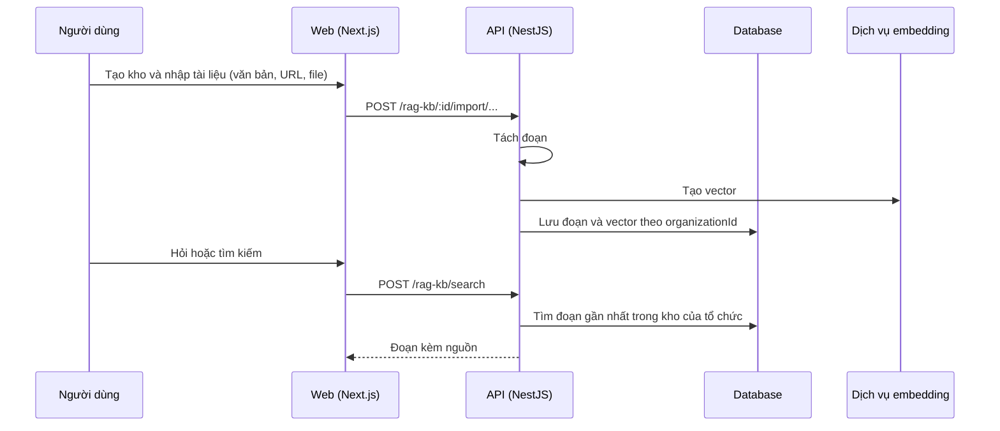

# F11: Kho kiến thức (RAG)

- **Nhóm:** B. Tổng quan và AI
- **Mức ưu tiên:** P1
- **Route giao diện:** `/knowledge-base`
- **API chính:**
  - `POST /rag-kb`
  - `POST /rag-kb/:id/import/text`
  - `POST /rag-kb/:id/import/url`
  - `POST /rag-kb/:id/import/file`
  - `POST /rag-kb/search`
  - `POST /rag-kb/:id/reindex`
  - `DELETE /rag-kb/:id/documents/:docId`

## Điều kiện trước khi test

- Có tài liệu mẫu (văn bản, URL, file)

## Sơ đồ sequence

## Các bước test

| # | Bước thực hiện | Kết quả mong đợi | Test tự động |
|---|---|---|---|
| 1 | Nhập tài liệu và truy vấn | Trả đoạn đúng nguồn | `test-rag-kb-all-features.ts` |
| 2 | Kho kiến thức dùng cho chatbot CSKH | Câu trả lời lấy từ kho đúng | `test-cskh-rag-kb.ts` |
| 3 | Tách kiến thức giữa hai dự án/tổ chức | Không lẫn nội dung | `test-cskh-project-isolation.ts` |
| 4 | Tách kiến thức theo tổ chức | Không lẫn nội dung | `test-cskh-kb-tenant-digi.ts` |
| 5 | Xóa tài liệu và lập lại chỉ mục | Kết quả tìm kiếm cập nhật | Thủ công |
| 6 | Nhập URL không truy cập được | Báo lỗi rõ ràng | Thủ công |

## Trường hợp biên và lỗi cần thử

- File lớn hoặc sai định dạng
- Tài liệu trùng lặp
- Câu hỏi không có trong kho (không bịa)

## Ghi chú

- Cột "Thủ công" nghĩa là chưa thấy test tự động tương ứng. Cần kiểm tra bằng tay hoặc viết test mới.
- Việc ghép test với bước dựa trên tên file, chưa mở đọc từng test. Chưa chạy lại để lấy baseline.
- Test có hậu tố `-live` hoặc `-e2e` gọi dịch vụ ngoài, chỉ chạy khi chủ động.
- Cách chạy và ma trận: `docs/test case/REGRESSION_MATRIX.md`.
