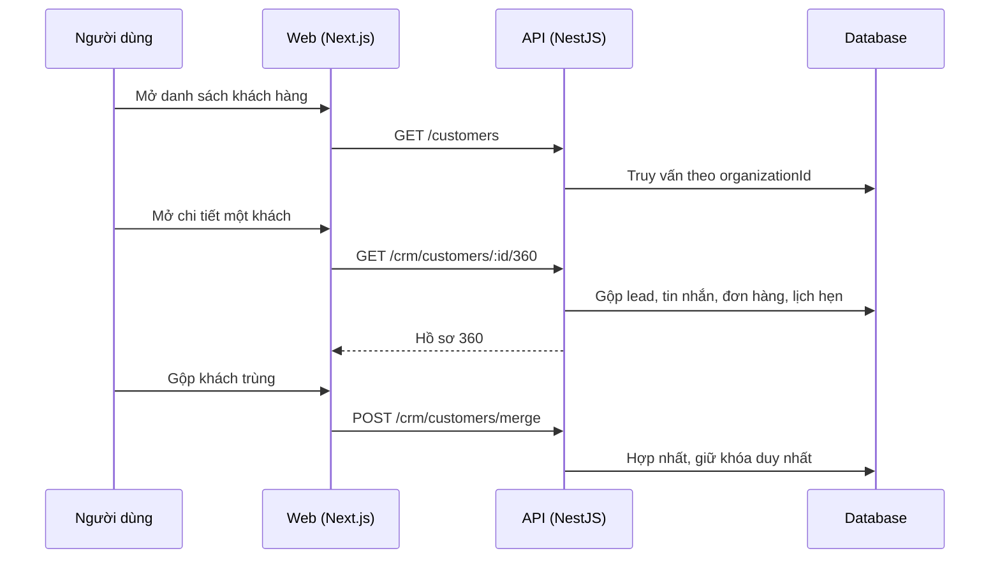

# F12: Khách hàng 360

- **Nhóm:** C. CRM
- **Mức ưu tiên:** P0
- **Route giao diện:** `/customers, /customers/[id]`
- **API chính:**
  - `GET /customers`
  - `POST /customers`
  - `GET /customers/:id`
  - `GET /crm/customers/:id/360`
  - `GET /crm/customers/:id/duplicates`
  - `POST /crm/customers/merge`
  - `GET /customers/:id/history`
  - `POST /customers/:id/notes`

## Điều kiện trước khi test

- Khách hàng có tương tác từ nhiều kênh (form, Zalo, Messenger)

## Sơ đồ sequence

## Các bước test

| # | Bước thực hiện | Kết quả mong đợi | Test tự động |
|---|---|---|---|
| 1 | Xem hồ sơ 360 gộp đủ kênh | Dữ liệu đúng và đầy đủ | `test-customer-360-omnichannel.ts` |
| 2 | Nguồn dữ liệu duy nhất (SSOT) | Không lệch số liệu giữa các màn hình | `test-customer-360-ssot.ts` |
| 3 | Khóa và chống trùng khách | Không tạo trùng | `test-customer-360-lock-unique.ts` |
| 4 | Hành trình khách hàng | Mốc thời gian đúng | `test-customer-journey.ts` |
| 5 | Danh tính liên hệ qua kênh nhắn tin | Ghép đúng một người | `test-messaging-contact-identity.ts` |
| 6 | Gộp hai khách trùng | Lịch sử được hợp nhất, không mất dữ liệu | Thủ công |
| 7 | Thêm ghi chú và xem lịch sử | Lưu và hiển thị đúng | Thủ công |

## Trường hợp biên và lỗi cần thử

- Hai khách cùng số điện thoại
- Khách đã xóa mềm
- Kiểm tra E2E trên production là test gọi thật (live)

## Ghi chú

- Cột "Thủ công" nghĩa là chưa thấy test tự động tương ứng. Cần kiểm tra bằng tay hoặc viết test mới.
- Việc ghép test với bước dựa trên tên file, chưa mở đọc từng test. Chưa chạy lại để lấy baseline.
- Test có hậu tố `-live` hoặc `-e2e` gọi dịch vụ ngoài, chỉ chạy khi chủ động.
- Cách chạy và ma trận: `docs/test case/REGRESSION_MATRIX.md`.
