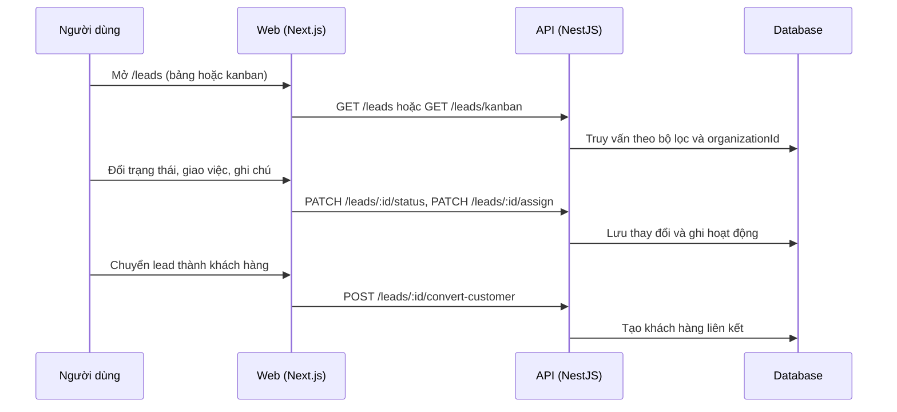

# F13: Quản lý lead

- **Nhóm:** C. CRM
- **Mức ưu tiên:** P1
- **Route giao diện:** `/leads`
- **API chính:**
  - `GET /leads`
  - `GET /leads/kanban`
  - `POST /leads`
  - `PATCH /leads/:id/status`
  - `PATCH /leads/:id/assign`
  - `POST /leads/:id/convert-customer`
  - `POST /leads/bulk`
  - `GET /leads/saved-views`

## Điều kiện trước khi test

- Có lead từ nhiều nguồn

## Sơ đồ sequence

## Các bước test

| # | Bước thực hiện | Kết quả mong đợi | Test tự động |
|---|---|---|---|
| 1 | Lọc, tìm, đổi trạng thái | Danh sách và kanban đúng | `test-leads-ux.ts` |
| 2 | Lead từ form landing page | Vào đúng tổ chức và nguồn | `test-landing-page-public-lead.ts` |
| 3 | Chấm điểm lead | Điểm đúng quy tắc | `test-funnel-lead-scoring.ts` |
| 4 | Bảng lead từ funnel | Số liệu đúng | `test-funnel-lead-dashboard.ts` |
| 5 | Giao lead và quy tắc phân công | Đúng người, đúng SLA | `test-assignment-sla.ts` |
| 6 | Thao tác hàng loạt và bộ lọc đã lưu | Áp dụng đúng | Thủ công |
| 7 | Chuyển thành khách hàng | Không tạo trùng khách | Thủ công |

## Trường hợp biên và lỗi cần thử

- Lead trùng số điện thoại
- Lead quá hạn chưa xử lý (cảnh báo)
- Xóa lead

## Ghi chú

- Cột "Thủ công" nghĩa là chưa thấy test tự động tương ứng. Cần kiểm tra bằng tay hoặc viết test mới.
- Việc ghép test với bước dựa trên tên file, chưa mở đọc từng test. Chưa chạy lại để lấy baseline.
- Test có hậu tố `-live` hoặc `-e2e` gọi dịch vụ ngoài, chỉ chạy khi chủ động.
- Cách chạy và ma trận: `docs/test case/REGRESSION_MATRIX.md`.
