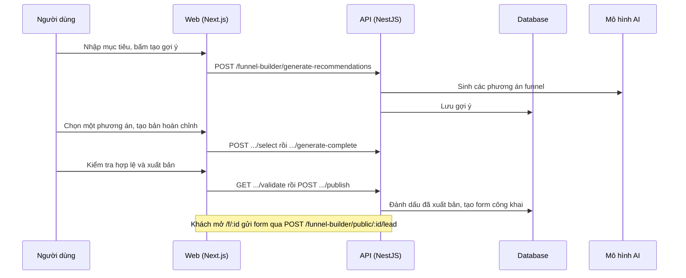

# F14: Funnel (xây dựng, xuất bản, thu lead)

- **Nhóm:** C. CRM
- **Mức ưu tiên:** P1
- **Route giao diện:** `/funnel, /funnel/preview/[id], /f/[id]`
- **API chính:**
  - `POST /funnel-builder/generate-recommendations`
  - `POST /funnel-builder/recommendations/:id/select`
  - `POST /funnel-builder/recommendations/:id/generate-complete`
  - `GET /funnel-builder/recommendations/:id/validate`
  - `POST /funnel-builder/recommendations/:id/publish`
  - `GET /funnel-builder/public/:id/form`
  - `POST /funnel-builder/public/:id/lead`

## Điều kiện trước khi test

- Có hồ sơ doanh nghiệp
- Còn hạn mức tạo funnel

## Sơ đồ sequence

## Các bước test

| # | Bước thực hiện | Kết quả mong đợi | Test tự động |
|---|---|---|---|
| 1 | Tạo gợi ý và chọn phương án | Có phương án đúng ngành | `test-funnel-consultant.ts` |
| 2 | Kiểm tra hợp lệ funnel | Báo lỗi thiếu bước, thiếu form | `test-funnel-validator.ts` |
| 3 | Dùng canvas funnel | Kéo, nối, chạy đúng | `test-funnel-canvas-runtime.ts` |
| 4 | Chỉnh nội dung tại chỗ | Lưu và hiển thị | `test-funnel-inline-edit.cjs` |
| 5 | Chuyển chế độ thiết kế | Không mất dữ liệu | `test-funnel-design-toggle.cjs` |
| 6 | Gửi form công khai | Tạo lead đúng | `test-funnel-form-capture.ts` |
| 7 | Tự động hóa và vòng khép kín | Lead đi đúng bước | `test-funnel-closed-loop.ts` |
| 8 | Xóa funnel | Dọn đúng dữ liệu liên quan | `test-funnel-delete.ts` |
| 9 | Vòng đời từ tạo đến thu lead | Đầy đủ | `test-funnel-lifecycle-e2e.ts` |

## Trường hợp biên và lỗi cần thử

- Hết hạn mức tạo funnel
- Xuất bản khi chưa hợp lệ
- Tạm dừng rồi lưu trữ funnel

## Ghi chú

- Cột "Thủ công" nghĩa là chưa thấy test tự động tương ứng. Cần kiểm tra bằng tay hoặc viết test mới.
- Việc ghép test với bước dựa trên tên file, chưa mở đọc từng test. Chưa chạy lại để lấy baseline.
- Test có hậu tố `-live` hoặc `-e2e` gọi dịch vụ ngoài, chỉ chạy khi chủ động.
- Cách chạy và ma trận: `docs/test case/REGRESSION_MATRIX.md`.
