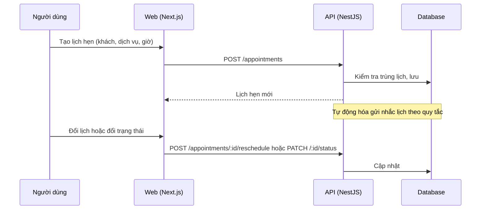

# F15: Lịch hẹn và dịch vụ

- **Nhóm:** C. CRM
- **Mức ưu tiên:** P1
- **Route giao diện:** `/appointments`
- **API chính:**
  - `GET /appointments`
  - `GET /appointments/calendar`
  - `GET /appointments/services`
  - `POST /appointments`
  - `PATCH /appointments/:id/status`
  - `POST /appointments/:id/reschedule`
  - `POST /appointments/:id/remind`
  - `DELETE /appointments/:id`

## Điều kiện trước khi test

- Có dịch vụ và khách hàng

## Sơ đồ sequence

## Các bước test

| # | Bước thực hiện | Kết quả mong đợi | Test tự động |
|---|---|---|---|
| 1 | Tạo lịch hẹn mới | Hiện trong lịch đúng giờ | Thủ công |
| 2 | Tự động hóa lịch hẹn trong CRM | Nhắc lịch và cập nhật đúng | `test-crm-appointment-automation.ts` |
| 3 | Đổi lịch, đổi trạng thái, hủy | Cập nhật đúng, có nhắc lại | Thủ công |
| 4 | Gửi nhắc lịch thủ công | Khách nhận đúng nội dung | Thủ công |
| 5 | Phân công và SLA | Đúng người phụ trách | `test-assignment-sla.ts` |
| 6 | Xem lịch theo ngày, tuần | Hiển thị đúng | Thủ công |

## Trường hợp biên và lỗi cần thử

- Hai lịch trùng giờ cùng nhân viên
- Lịch quá khứ
- Khách hủy sát giờ

## Ghi chú

- Cột "Thủ công" nghĩa là chưa thấy test tự động tương ứng. Cần kiểm tra bằng tay hoặc viết test mới.
- Việc ghép test với bước dựa trên tên file, chưa mở đọc từng test. Chưa chạy lại để lấy baseline.
- Test có hậu tố `-live` hoặc `-e2e` gọi dịch vụ ngoài, chỉ chạy khi chủ động.
- Cách chạy và ma trận: `docs/test case/REGRESSION_MATRIX.md`.
