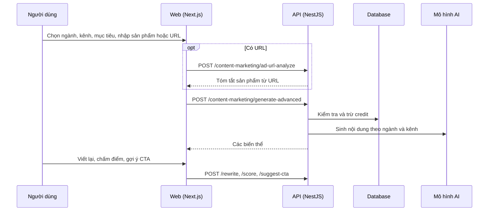

# F16: Tạo nội dung quảng cáo

- **Nhóm:** E. Nội dung
- **Mức ưu tiên:** P1
- **Route giao diện:** `/content-marketing?tab=create&section=ad`
- **API chính:**
  - `POST /content-marketing/generate`
  - `POST /content-marketing/generate-advanced`
  - `POST /content-marketing/ad-url-analyze`
  - `POST /content-marketing/rewrite`
  - `POST /content-marketing/score`
  - `POST /content-marketing/suggest-cta`

## Điều kiện trước khi test

- Đủ credit AI
- Ngành đã chọn

## Sơ đồ sequence

## Các bước test

| # | Bước thực hiện | Kết quả mong đợi | Test tự động |
|---|---|---|---|
| 1 | Tạo nội dung theo ngành và kênh | Có biến thể đúng kênh | `test-content-marketing-logic.cjs` |
| 2 | Biến thể kênh nâng cao | Đúng định dạng từng kênh | `test-advanced-channel-variants.ts` |
| 3 | Tạo bài theo sản phẩm hoặc dịch vụ | Nội dung bám sản phẩm | `test-ad-product-service-posts.ts` |
| 4 | Phân tích URL quảng cáo | Tóm tắt đúng, hủy được tiến trình | `test-ad-url-analyze.ts` |
| 5 | Viết lại và tối ưu CTA | Kết quả khác bản gốc, giữ ý | Thủ công |
| 6 | Hết credit | Báo rõ, không mất dữ liệu đã nhập | Thủ công |

## Trường hợp biên và lỗi cần thử

- URL không truy cập được
- Nội dung vi phạm chính sách (xem F18)
- AI trả rỗng

## Ghi chú

- Cột "Thủ công" nghĩa là chưa thấy test tự động tương ứng. Cần kiểm tra bằng tay hoặc viết test mới.
- Việc ghép test với bước dựa trên tên file, chưa mở đọc từng test. Chưa chạy lại để lấy baseline.
- Test có hậu tố `-live` hoặc `-e2e` gọi dịch vụ ngoài, chỉ chạy khi chủ động.
- Cách chạy và ma trận: `docs/test case/REGRESSION_MATRIX.md`.
