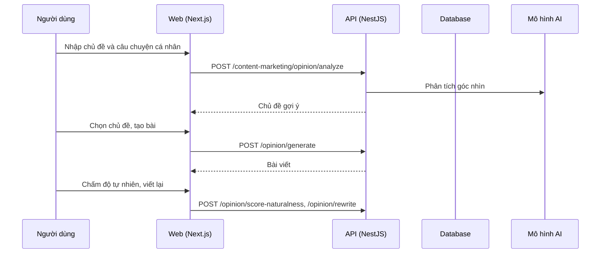

# F17: Xây dựng thương hiệu cá nhân và nội dung quan điểm

- **Nhóm:** E. Nội dung
- **Mức ưu tiên:** P2
- **Route giao diện:** `/content-marketing?tab=create&section=personal`
- **API chính:**
  - `POST /content-marketing/suggest-personal-ideas`
  - `POST /content-marketing/suggest-personal-titles`
  - `POST /content-marketing/opinion/analyze`
  - `POST /content-marketing/opinion/generate`
  - `POST /content-marketing/opinion/rewrite`
  - `POST /content-marketing/opinion/score-naturalness`

## Điều kiện trước khi test

- Đủ credit AI

## Sơ đồ sequence

## Các bước test

| # | Bước thực hiện | Kết quả mong đợi | Test tự động |
|---|---|---|---|
| 1 | Chủ đề thương hiệu | Chủ đề phù hợp | `test-brand-topic-themes.ts` |
| 2 | Danh xưng cá nhân | Đúng ngôi, đúng xưng hô | `test-personal-titles.ts` |
| 3 | Phân tích quan điểm | Kết quả có cấu trúc | `test-opinion-analyze.ts` |
| 4 | Tạo bài quan điểm | Bài đủ độ dài, đúng giọng | `test-opinion-generate.ts` |
| 5 | Gợi ý chủ đề | Chủ đề không trùng | `test-opinion-topics.ts` |
| 6 | Luồng hoàn chỉnh | Từ phân tích đến bài hoàn chỉnh | `test-opinion-complete.ts` |

## Trường hợp biên và lỗi cần thử

- Nội dung nhạy cảm
- Câu chuyện quá ngắn

## Ghi chú

- Cột "Thủ công" nghĩa là chưa thấy test tự động tương ứng. Cần kiểm tra bằng tay hoặc viết test mới.
- Việc ghép test với bước dựa trên tên file, chưa mở đọc từng test. Chưa chạy lại để lấy baseline.
- Test có hậu tố `-live` hoặc `-e2e` gọi dịch vụ ngoài, chỉ chạy khi chủ động.
- Cách chạy và ma trận: `docs/test case/REGRESSION_MATRIX.md`.
