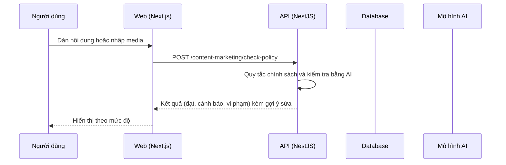

# F18: Kiểm tra chính sách quảng cáo Facebook

- **Nhóm:** E. Nội dung
- **Mức ưu tiên:** P1
- **Route giao diện:** `/content-marketing?tab=create&section=facebook-check`
- **API chính:**
  - `POST /content-marketing/check-policy`

## Điều kiện trước khi test

- Nội dung mẫu có và không vi phạm
- Có ảnh mẫu để nhập media

## Sơ đồ sequence

## Các bước test

| # | Bước thực hiện | Kết quả mong đợi | Test tự động |
|---|---|---|---|
| 1 | Kiểm tra nội dung theo chính sách | Phát hiện đúng các mục vi phạm | `test-facebook-policy-check.ts` |
| 2 | Nhập media và đọc nội dung từ ảnh | Đọc đúng | `test-facebook-policy-import-media.ts` |
| 3 | Giao diện kết quả | Hiển thị đúng mức độ | `test-facebook-policy-ui.ts` |
| 4 | Nội dung sạch | Không báo nhầm | Thủ công |
| 5 | Gợi ý sửa | Có hướng dẫn cụ thể | Thủ công |

## Trường hợp biên và lỗi cần thử

- Ảnh quá lớn hoặc sai định dạng
- Nội dung rất dài

## Ghi chú

- Cột "Thủ công" nghĩa là chưa thấy test tự động tương ứng. Cần kiểm tra bằng tay hoặc viết test mới.
- Việc ghép test với bước dựa trên tên file, chưa mở đọc từng test. Chưa chạy lại để lấy baseline.
- Test có hậu tố `-live` hoặc `-e2e` gọi dịch vụ ngoài, chỉ chạy khi chủ động.
- Cách chạy và ma trận: `docs/test case/REGRESSION_MATRIX.md`.
