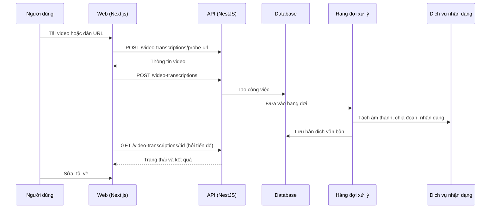

# F19: Video transcript (chuyển video thành văn bản)

- **Nhóm:** E. Nội dung
- **Mức ưu tiên:** P1
- **Route giao diện:** `/content-marketing?tab=create&section=video-transcript`
- **API chính:**
  - `POST /video-transcriptions`
  - `POST /video-transcriptions/probe-url`
  - `GET /video-transcriptions/:id`
  - `POST /video-transcriptions/:id/retry`
  - `POST /video-transcriptions/:id/cancel`
  - `GET /video-transcriptions/:id/download-transcript`

## Điều kiện trước khi test

- File video ngắn hoặc URL YouTube
- Hàng đợi xử lý hoạt động

## Sơ đồ sequence

## Các bước test

| # | Bước thực hiện | Kết quả mong đợi | Test tự động |
|---|---|---|---|
| 1 | Chuyển video thành văn bản | Có bản dịch đủ nội dung | `test-video-transcription.ts` |
| 2 | Độ chính xác trên mẫu chuẩn | Đạt ngưỡng | `test-video-transcription-accuracy.ts` |
| 3 | Tùy chọn giữ video | Video được giữ hoặc xóa đúng | `test-video-transcription-keepvideo.ts` |
| 4 | Lấy từ YouTube | Có bản dịch | `test-video-transcription-youtube-e2e.ts` |
| 5 | Hủy, thử lại, thử lại từng đoạn | Trạng thái đúng | Thủ công |
| 6 | Tải bản dịch | File đúng nội dung | Thủ công |

## Trường hợp biên và lỗi cần thử

- Video rất dài
- URL riêng tư hoặc bị chặn
- Hết credit giữa chừng

## Ghi chú

- Cột "Thủ công" nghĩa là chưa thấy test tự động tương ứng. Cần kiểm tra bằng tay hoặc viết test mới.
- Việc ghép test với bước dựa trên tên file, chưa mở đọc từng test. Chưa chạy lại để lấy baseline.
- Test có hậu tố `-live` hoặc `-e2e` gọi dịch vụ ngoài, chỉ chạy khi chủ động.
- Cách chạy và ma trận: `docs/test case/REGRESSION_MATRIX.md`.
