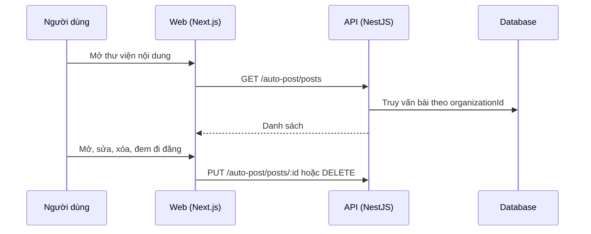

# F20: Thư viện nội dung

- **Nhóm:** E. Nội dung
- **Mức ưu tiên:** P2
- **Route giao diện:** `/content-marketing?tab=library`
- **API chính:**
  - `GET /auto-post/posts`
  - `POST /auto-post/drafts`
  - `PUT /auto-post/posts/:id`
  - `DELETE /auto-post/posts/:id`

## Điều kiện trước khi test

- Có một số bài đã lưu

## Sơ đồ sequence

## Các bước test

| # | Bước thực hiện | Kết quả mong đợi | Test tự động |
|---|---|---|---|
| 1 | Mở thư viện và tìm bài | Danh sách đúng | Thủ công |
| 2 | Sửa bài đã lưu | Lưu thành công | Thủ công |
| 3 | Xóa bài | Bài biến mất, không ảnh hưởng bài khác | Thủ công |
| 4 | Đem bài sang đăng hoặc lên lịch | Chuyển đúng sang F21 | Thủ công |
| 5 | Lưu từ ý tưởng Autopilot (F09) | Bài xuất hiện trong thư viện | Thủ công |

## Trường hợp biên và lỗi cần thử

- Thư viện rất nhiều bài
- Bài đã đăng thì sửa thế nào

## Ghi chú

- Cột "Thủ công" nghĩa là chưa thấy test tự động tương ứng. Cần kiểm tra bằng tay hoặc viết test mới.
- Việc ghép test với bước dựa trên tên file, chưa mở đọc từng test. Chưa chạy lại để lấy baseline.
- Test có hậu tố `-live` hoặc `-e2e` gọi dịch vụ ngoài, chỉ chạy khi chủ động.
- Cách chạy và ma trận: `docs/test case/REGRESSION_MATRIX.md`.
