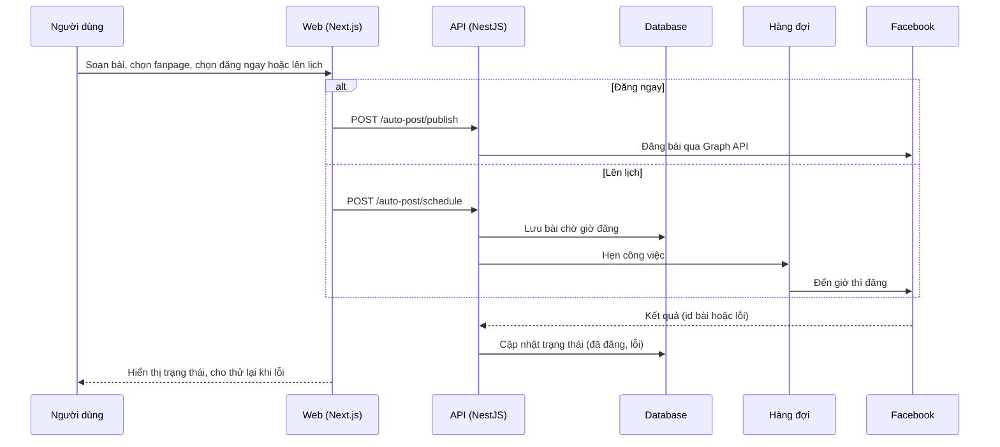

# F21: Đăng bài tự động và lên lịch

- **Nhóm:** E. Nội dung
- **Mức ưu tiên:** P0
- **Route giao diện:** `/content-marketing?tab=auto-post|schedule`
- **API chính:**
  - `POST /auto-post/ai/generate`
  - `POST /auto-post/drafts`
  - `POST /auto-post/publish`
  - `POST /auto-post/schedule`
  - `POST /auto-post/schedule/:id/cancel`
  - `POST /auto-post/posts/:id/retry`

## Điều kiện trước khi test

- Một fanpage đã kết nối (F22)
- Một fanpage thử để đăng

## Sơ đồ sequence

## Các bước test

| # | Bước thực hiện | Kết quả mong đợi | Test tự động |
|---|---|---|---|
| 1 | Quy trình đăng bài tự động | Trạng thái chuyển đúng | `test-auto-post.cjs` |
| 2 | Phân quyền theo trạng thái bài | Chỉ người có quyền mới sửa hoặc duyệt | `test-auto-post-status-rbac.ts` |
| 3 | Đăng thật end-to-end (chỉ chạy chủ động) | Bài xuất hiện trên fanpage thử | `test-auto-post-publish-e2e.ts` |
| 4 | Lên lịch rồi hủy lịch | Không đăng sau khi hủy | Thủ công |
| 5 | Lịch đúng múi giờ | Đăng đúng giờ địa phương | Thủ công |
| 6 | Đăng lỗi rồi bấm thử lại | Thử lại thành công hoặc báo lỗi rõ | Thủ công |

## Trường hợp biên và lỗi cần thử

- Token fanpage hết hạn
- Bài trùng nội dung
- Server khởi động lại khi đang có bài chờ giờ

## Ghi chú

- Cột "Thủ công" nghĩa là chưa thấy test tự động tương ứng. Cần kiểm tra bằng tay hoặc viết test mới.
- Việc ghép test với bước dựa trên tên file, chưa mở đọc từng test. Chưa chạy lại để lấy baseline.
- Test có hậu tố `-live` hoặc `-e2e` gọi dịch vụ ngoài, chỉ chạy khi chủ động.
- Cách chạy và ma trận: `docs/test case/REGRESSION_MATRIX.md`.
