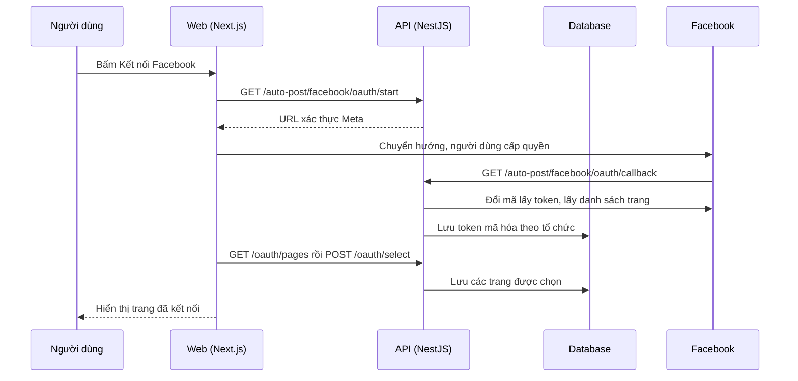

# F22: Kết nối fanpage (Meta OAuth)

- **Nhóm:** E. Nội dung
- **Mức ưu tiên:** P0
- **Route giao diện:** `/content-marketing?tab=channels`
- **API chính:**
  - `GET /auto-post/facebook/oauth/start`
  - `GET /auto-post/facebook/oauth/callback`
  - `GET /auto-post/facebook/oauth/pages`
  - `POST /auto-post/facebook/oauth/select`
  - `GET /auto-post/facebook/status`
  - `POST /auto-post/facebook/disconnect`
  - `POST /auto-post/facebook/pages/:fanpageId/sync`
  - `POST /auto-post/facebook/deauthorize`
  - `POST /auto-post/facebook/data-deletion`

## Điều kiện trước khi test

- Tài khoản Facebook thử có quyền quản lý trang
- Ứng dụng Meta cấu hình đúng callback

## Sơ đồ sequence

## Các bước test

| # | Bước thực hiện | Kết quả mong đợi | Test tự động |
|---|---|---|---|
| 1 | Callback OAuth Meta | Xử lý đúng trạng thái và lỗi | `test-auto-post-meta-callbacks.ts` |
| 2 | Đăng nhập Facebook cho doanh nghiệp | Đúng luồng | `test-auto-post-facebook-login-for-business.ts` |
| 3 | Tiện ích lấy danh sách trang | Danh sách đúng | `test-auto-post-meta-pages-util.ts` |
| 4 | Quyền fanpage | Báo thiếu quyền rõ ràng | `test-fanpage-permissions.ts` |
| 5 | Chi tiết fanpage | Hiển thị đúng | `test-fanpage-details.ts` |
| 6 | Trạng thái kênh trên giao diện | Đúng ở mọi trạng thái | `test-facebook-channel-ui-states.ts` |
| 7 | Ngắt kết nối và xóa dữ liệu theo yêu cầu Meta | Token và dữ liệu bị xóa | Thủ công |
| 8 | Kiểm tra quyền cho app review (chủ động) | Đạt yêu cầu Meta | `test-pages-manage-posts-review.ts` |

## Trường hợp biên và lỗi cần thử

- Người dùng từ chối quyền
- Token hết hạn hoặc bị thu hồi
- Một trang đã kết nối ở tổ chức khác

## Ghi chú

- Cột "Thủ công" nghĩa là chưa thấy test tự động tương ứng. Cần kiểm tra bằng tay hoặc viết test mới.
- Việc ghép test với bước dựa trên tên file, chưa mở đọc từng test. Chưa chạy lại để lấy baseline.
- Test có hậu tố `-live` hoặc `-e2e` gọi dịch vụ ngoài, chỉ chạy khi chủ động.
- Cách chạy và ma trận: `docs/test case/REGRESSION_MATRIX.md`.
