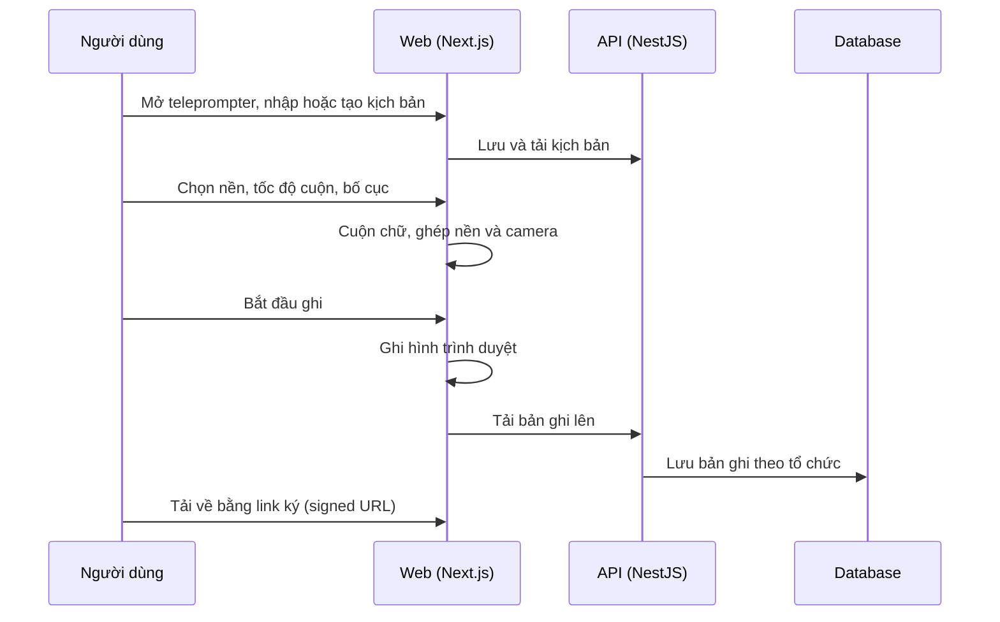

# F23: Teleprompter (kịch bản, cuộn, ghi hình)

- **Nhóm:** E. Nội dung
- **Mức ưu tiên:** P2
- **Route giao diện:** `/teleprompter`
- **API chính:**
  - `GET /content-marketing/teleprompter-signed/:id`

## Điều kiện trước khi test

- Một kịch bản mẫu
- Trình duyệt cho phép camera

## Sơ đồ sequence

## Các bước test

| # | Bước thực hiện | Kết quả mong đợi | Test tự động |
|---|---|---|---|
| 1 | Kịch bản: API, công cụ, lưu trữ | Lưu và tải đúng | `test-teleprompter-script-api.ts` |
| 2 | Động cơ cuộn chữ | Tốc độ đúng, không giật | `test-teleprompter-scroll-engine.ts` |
| 3 | Bố cục và ghép lớp | Đúng vị trí chữ và camera | `test-teleprompter-layout-compositor.ts` |
| 4 | Ghi hình và bản ghi | Có file, phát lại được | `test-teleprompter-recorder.ts` |
| 5 | Nền: làm mờ, mặt nạ, chuyển động, tùy chỉnh | Hiển thị đúng | `test-teleprompter-background-blur.ts` |
| 6 | Hiệu năng nền | Không tụt khung hình quá mức | `test-teleprompter-background-perf.ts` |
| 7 | Tách dữ liệu theo tổ chức | Không thấy bản ghi của người khác | `test-teleprompter-source-tenant.ts` |
| 8 | Tải bản ghi bằng link ký | Link hết hạn đúng | Thủ công |

## Trường hợp biên và lỗi cần thử

- Không có quyền camera
- Kịch bản rất dài
- Trình duyệt không hỗ trợ ghi

## Ghi chú

- Cột "Thủ công" nghĩa là chưa thấy test tự động tương ứng. Cần kiểm tra bằng tay hoặc viết test mới.
- Việc ghép test với bước dựa trên tên file, chưa mở đọc từng test. Chưa chạy lại để lấy baseline.
- Test có hậu tố `-live` hoặc `-e2e` gọi dịch vụ ngoài, chỉ chạy khi chủ động.
- Cách chạy và ma trận: `docs/test case/REGRESSION_MATRIX.md`.
