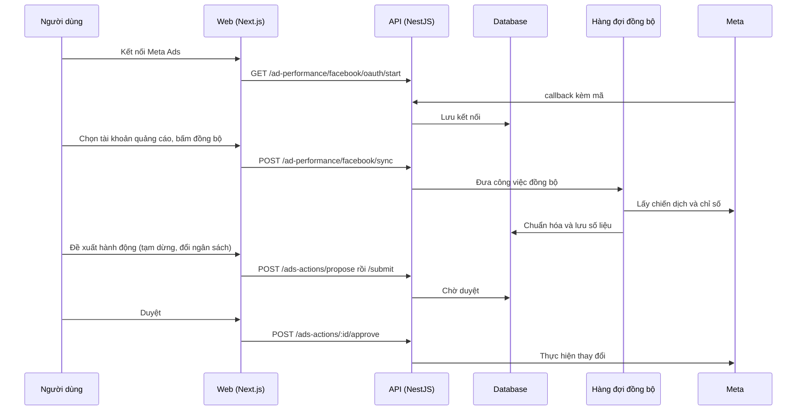

# F24: Quảng cáo Meta (kết nối, đồng bộ, hành động)

- **Nhóm:** F. Quảng cáo
- **Mức ưu tiên:** P0
- **Route giao diện:** `/ads`
- **API chính:**
  - `GET /ad-performance/facebook/oauth/start`
  - `GET /ad-performance/facebook/oauth/callback`
  - `GET /ad-performance/facebook/ad-accounts`
  - `POST /ad-performance/facebook/sync`
  - `GET /ad-performance/facebook/campaigns`
  - `POST /ads-actions/propose`
  - `POST /ads-actions/:id/approve`

## Điều kiện trước khi test

- Tài khoản quảng cáo Meta thử
- Hàng đợi đồng bộ hoạt động

## Sơ đồ sequence

## Các bước test

| # | Bước thực hiện | Kết quả mong đợi | Test tự động |
|---|---|---|---|
| 1 | Chỉ số chuẩn hóa | Số liệu đúng quy ước | `test-ads-normalized-metrics.ts` |
| 2 | Đồng bộ qua hàng đợi | Không mất, không trùng | `test-ads-sync-queue.ts` |
| 3 | Chỉ số hiệu suất quảng cáo | Tính đúng CPA, ROAS | `test-ad-performance-metrics.cjs` |
| 4 | Yêu cầu hành động và duyệt | Chỉ thực hiện sau khi duyệt | `test-ads-action-request.ts` |
| 5 | Hardening Meta | Xử lý lỗi và giới hạn API | `test-ads-meta-harden.ts` |
| 6 | Tối ưu Meta Graph | Giảm số lần gọi | `test-meta-graph-saas-opt.ts` |
| 7 | Hợp nhất nguồn, MCP gateway | Đúng quyền | `test-ads-unification.ts` |
| 8 | OAuth và app review (chủ động) | Đúng luồng | `test-meta-ads-oauth-redirect.ts` |
| 9 | Máy tính mục tiêu quảng cáo | Số liệu đúng | `test-ad-goal-calculator.ts` |

## Trường hợp biên và lỗi cần thử

- Token Meta hết hạn
- Giới hạn tốc độ của Meta
- Ngắt kết nối giữa lúc đồng bộ

## Ghi chú

- Cột "Thủ công" nghĩa là chưa thấy test tự động tương ứng. Cần kiểm tra bằng tay hoặc viết test mới.
- Việc ghép test với bước dựa trên tên file, chưa mở đọc từng test. Chưa chạy lại để lấy baseline.
- Test có hậu tố `-live` hoặc `-e2e` gọi dịch vụ ngoài, chỉ chạy khi chủ động.
- Cách chạy và ma trận: `docs/test case/REGRESSION_MATRIX.md`.
