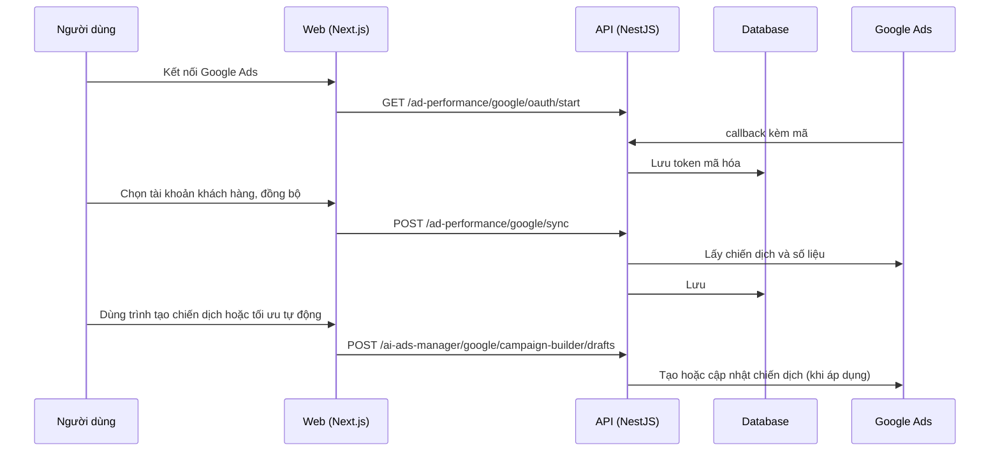

# F25: Quảng cáo Google Ads

- **Nhóm:** F. Quảng cáo
- **Mức ưu tiên:** P0
- **Route giao diện:** `/ads`
- **API chính:**
  - `GET /ad-performance/google/oauth/start`
  - `GET /ad-performance/google/oauth/callback`
  - `GET /ad-performance/google/customers`
  - `POST /ad-performance/google/sync`
  - `GET /ad-performance/google/sync-jobs/:jobId`
  - `POST /ai-ads-manager/google/campaign-builder/drafts`
  - `POST /ai-ads-manager/campaigns/optimize`

## Điều kiện trước khi test

- Tài khoản Google Ads thử
- Cấu hình developer token

## Sơ đồ sequence

## Các bước test

| # | Bước thực hiện | Kết quả mong đợi | Test tự động |
|---|---|---|---|
| 1 | OAuth Google Ads | Chuyển hướng và lưu token đúng | `test-ads-google-oauth.ts` |
| 2 | Chuyển hướng OAuth end-to-end | Quay về đúng trang | `test-google-ads-oauth-redirect-e2e.cjs` |
| 3 | Trình tạo chiến dịch | Bản nháp hợp lệ | `test-google-ads-campaign-builder.cjs` |
| 4 | Tự áp dụng và autopilot | Chỉ áp dụng khi bật, có hàng rào | `test-google-ads-auto-apply.cjs` |
| 5 | Engine dữ liệu | Số liệu đúng | `test-google-ads-data-engine.cjs` |
| 6 | Engine tối ưu | Đề xuất hợp lý | `test-google-ads-optimization-engine.cjs` |
| 7 | Đa tổ chức | Không lẫn tài khoản giữa tổ chức | `test-google-ads-saas-multi-tenant.cjs` |
| 8 | Kiểm toán đầy đủ | Không phát sinh lỗi cũ | `test-google-ads-full-audit.cjs` |
| 9 | Chạy trên production (chủ động) | Đạt | `test-google-ads-prod-e2e.cjs` |

## Trường hợp biên và lỗi cần thử

- Developer token chưa duyệt
- Khách hàng Google Ads bị tạm ngưng
- Tắt khẩn cấp chế độ tự động (emergency stop)

## Ghi chú

- Cột "Thủ công" nghĩa là chưa thấy test tự động tương ứng. Cần kiểm tra bằng tay hoặc viết test mới.
- Việc ghép test với bước dựa trên tên file, chưa mở đọc từng test. Chưa chạy lại để lấy baseline.
- Test có hậu tố `-live` hoặc `-e2e` gọi dịch vụ ngoài, chỉ chạy khi chủ động.
- Cách chạy và ma trận: `docs/test case/REGRESSION_MATRIX.md`.
