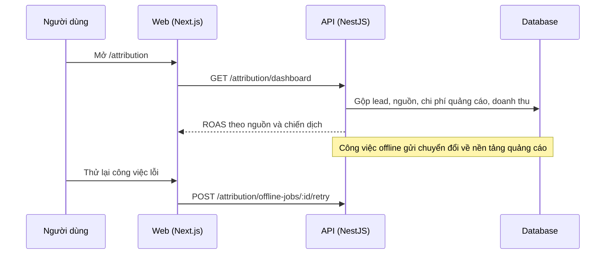

# F26: Attribution và ROAS

- **Nhóm:** F. Quảng cáo
- **Mức ưu tiên:** P1
- **Route giao diện:** `/attribution`
- **API chính:**
  - `GET /attribution/dashboard`
  - `GET /attribution/leads/:leadId`
  - `POST /attribution/leads/:leadId`
  - `GET /attribution/offline-jobs`
  - `POST /attribution/offline-jobs/:id/retry`

## Điều kiện trước khi test

- Lead có UTM hoặc click id
- Đơn hàng gắn với lead

## Sơ đồ sequence

## Các bước test

| # | Bước thực hiện | Kết quả mong đợi | Test tự động |
|---|---|---|---|
| 1 | Quy chiếu nguồn chuyển đổi cho lead | Gắn đúng nguồn | `test-marketing-attribution.ts` |
| 2 | Số liệu mục tiêu kinh doanh | Khớp với dữ liệu | `test-business-goal-metrics.ts` |
| 3 | Dashboard ROAS | Công thức đúng | Thủ công |
| 4 | Gắn nguồn thủ công cho lead | Cập nhật lại báo cáo | Thủ công |
| 5 | Thử lại công việc chuyển đổi offline | Trạng thái đúng | Thủ công |

## Trường hợp biên và lỗi cần thử

- Lead không có UTM
- Một lead nhiều nguồn
- Doanh thu hoàn trả

## Ghi chú

- Cột "Thủ công" nghĩa là chưa thấy test tự động tương ứng. Cần kiểm tra bằng tay hoặc viết test mới.
- Việc ghép test với bước dựa trên tên file, chưa mở đọc từng test. Chưa chạy lại để lấy baseline.
- Test có hậu tố `-live` hoặc `-e2e` gọi dịch vụ ngoài, chỉ chạy khi chủ động.
- Cách chạy và ma trận: `docs/test case/REGRESSION_MATRIX.md`.
