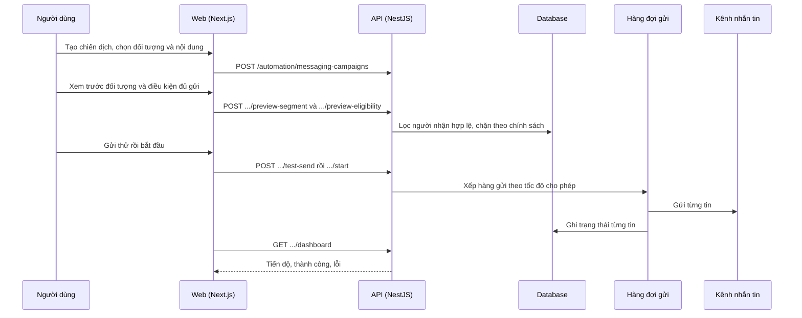

# F27: Chiến dịch nhắn tin hàng loạt

- **Nhóm:** G. Nhắn tin
- **Mức ưu tiên:** P0
- **Route giao diện:** `/automation?tab=campaigns`
- **API chính:**
  - `POST /automation/messaging-campaigns`
  - `POST /automation/messaging-campaigns/:id/preview-segment`
  - `POST /automation/messaging-campaigns/:id/preview-eligibility`
  - `POST /automation/messaging-campaigns/:id/test-send`
  - `POST /automation/messaging-campaigns/:id/schedule`
  - `POST /automation/messaging-campaigns/:id/start`
  - `POST /automation/messaging-campaigns/:id/pause`
  - `GET /automation/messaging-campaigns/:id/dashboard`

## Điều kiện trước khi test

- Một kênh (Messenger hoặc Zalo) đã kết nối
- Tập người nhận thử

## Sơ đồ sequence

## Các bước test

| # | Bước thực hiện | Kết quả mong đợi | Test tự động |
|---|---|---|---|
| 1 | Tạo chiến dịch | Lưu đúng nội dung và đối tượng | `test-messaging-campaign.ts` |
| 2 | Hàng đợi gửi | Gửi theo thứ tự, không gửi trùng | `test-messaging-campaign-queue.ts` |
| 3 | Điều kiện đủ để gửi | Chặn người không đủ điều kiện | `test-messaging-eligibility.ts` |
| 4 | Chống spam | Giới hạn tần suất theo chính sách | `test-messaging-anti-spam.ts` |
| 5 | Chạy thử không gửi thật (dry run) | Báo kết quả dự kiến | `test-messaging-dryrun-e2e.ts` |
| 6 | Cá nhân hóa tên | Biến tên thay đúng | `test-messaging-name-personalize-e2e.ts` |
| 7 | Kênh kết nối | Trạng thái đúng | `test-messaging-channel-connections.ts` |
| 8 | Gửi hàng loạt thật (chỉ chạy chủ động) | Tin đến người nhận thử | `test-messaging-bulk-live-e2e.ts` |
| 9 | Tạm dừng, tiếp tục, hủy chiến dịch | Dừng đúng, không gửi thêm | Thủ công |

## Trường hợp biên và lỗi cần thử

- Người nhận đã từ chối nhận tin
- Kênh mất kết nối giữa chừng
- Cửa sổ 24 giờ của nền tảng

## Ghi chú

- Cột "Thủ công" nghĩa là chưa thấy test tự động tương ứng. Cần kiểm tra bằng tay hoặc viết test mới.
- Việc ghép test với bước dựa trên tên file, chưa mở đọc từng test. Chưa chạy lại để lấy baseline.
- Test có hậu tố `-live` hoặc `-e2e` gọi dịch vụ ngoài, chỉ chạy khi chủ động.
- Cách chạy và ma trận: `docs/test case/REGRESSION_MATRIX.md`.
