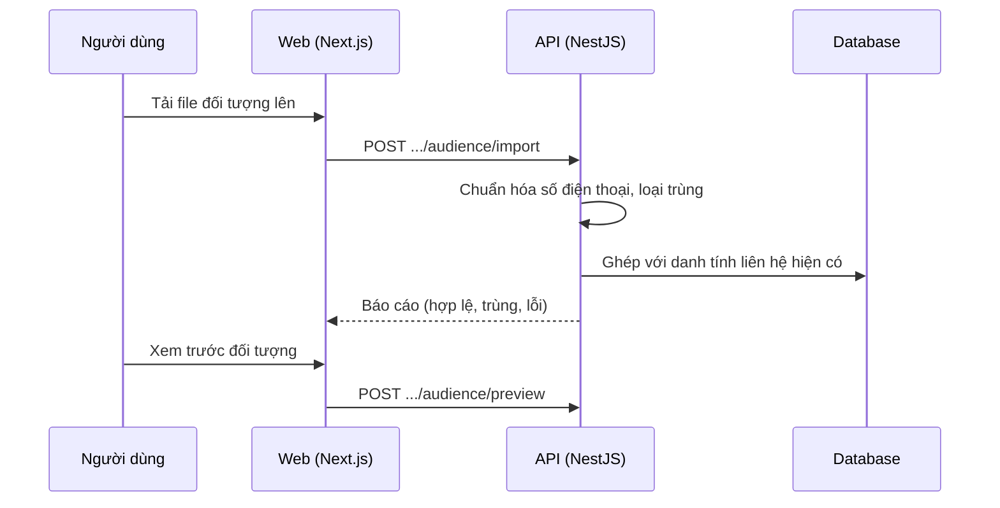

# F28: File đối tượng (audience)

- **Nhóm:** G. Nhắn tin
- **Mức ưu tiên:** P1
- **Route giao diện:** `/automation?tab=audience`
- **API chính:**
  - `POST /zalo-marketing/audience/import`
  - `POST /zalo-marketing/audience/preview`
  - `GET /messaging-identities`
  - `POST /messaging-identities/merge`

## Điều kiện trước khi test

- File mẫu CSV hoặc Excel có số điện thoại trùng và sai định dạng

## Sơ đồ sequence

## Các bước test

| # | Bước thực hiện | Kết quả mong đợi | Test tự động |
|---|---|---|---|
| 1 | Tải file mẫu hợp lệ | Báo đúng số hợp lệ, trùng, lỗi | Thủ công |
| 2 | File có dòng sai định dạng | Bỏ qua và báo từng dòng lỗi | Thủ công |
| 3 | Ghép danh tính với khách hiện có | Không tạo trùng | `test-messaging-contact-identity.ts` |
| 4 | Gộp và hoàn tác gộp danh tính | Đúng, hoàn tác được | Thủ công |
| 5 | Xem trước đối tượng | Số lượng khớp | Thủ công |

## Trường hợp biên và lỗi cần thử

- File rất lớn
- Mã hóa tiếng Việt trong CSV
- Số điện thoại quốc tế

## Ghi chú

- Cột "Thủ công" nghĩa là chưa thấy test tự động tương ứng. Cần kiểm tra bằng tay hoặc viết test mới.
- Việc ghép test với bước dựa trên tên file, chưa mở đọc từng test. Chưa chạy lại để lấy baseline.
- Test có hậu tố `-live` hoặc `-e2e` gọi dịch vụ ngoài, chỉ chạy khi chủ động.
- Cách chạy và ma trận: `docs/test case/REGRESSION_MATRIX.md`.
