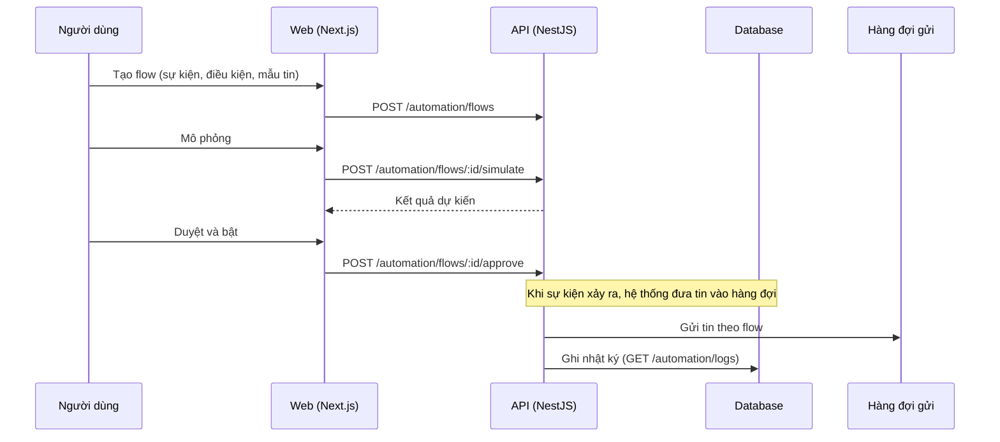

# F29: Tin nhắn tự động (flow tự động)

- **Nhóm:** G. Nhắn tin
- **Mức ưu tiên:** P1
- **Route giao diện:** `/automation?tab=flows`
- **API chính:**
  - `GET /automation/flows`
  - `POST /automation/flows`
  - `POST /automation/flows/:id/approve`
  - `PATCH /automation/flows/:id/pause`
  - `POST /automation/flows/:id/simulate`
  - `GET /automation/templates`
  - `POST /automation/templates/:id/preview`
  - `GET /automation/logs`

## Điều kiện trước khi test

- Một mẫu tin và một sự kiện kích hoạt (lead mới, đặt lịch)

## Sơ đồ sequence

## Các bước test

| # | Bước thực hiện | Kết quả mong đợi | Test tự động |
|---|---|---|---|
| 1 | Bảo mật tự động hóa (quyền, nội dung) | Không lộ dữ liệu, không gửi trái phép | `test-automation-security.ts` |
| 2 | Xem trước mẫu với biến | Biến thay đúng | Thủ công |
| 3 | Mô phỏng flow | Kết quả khớp kỳ vọng | Thủ công |
| 4 | Duyệt và bật flow | Chạy khi có sự kiện | Thủ công |
| 5 | Tạm dừng flow | Không gửi thêm | Thủ công |
| 6 | Xem nhật ký | Đủ thông tin từng lần chạy | Thủ công |

## Trường hợp biên và lỗi cần thử

- Vòng lặp tự gọi nhau
- Sự kiện đến trùng lặp
- Người nhận đã từ chối

## Ghi chú

- Cột "Thủ công" nghĩa là chưa thấy test tự động tương ứng. Cần kiểm tra bằng tay hoặc viết test mới.
- Việc ghép test với bước dựa trên tên file, chưa mở đọc từng test. Chưa chạy lại để lấy baseline.
- Test có hậu tố `-live` hoặc `-e2e` gọi dịch vụ ngoài, chỉ chạy khi chủ động.
- Cách chạy và ma trận: `docs/test case/REGRESSION_MATRIX.md`.
