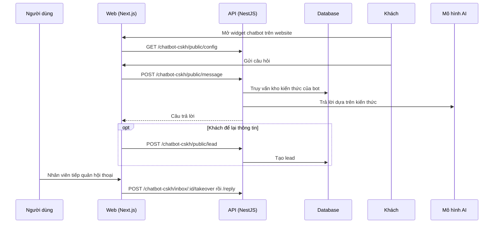

# F30: Chatbot CSKH (bot, kênh, hộp thư)

- **Nhóm:** G. Nhắn tin
- **Mức ưu tiên:** P1
- **Route giao diện:** `/chatbot-cskh`
- **API chính:**
  - `POST /chatbot-cskh/bots`
  - `POST /chatbot-cskh/knowledge`
  - `GET /chatbot-cskh/inbox`
  - `POST /chatbot-cskh/inbox/:id/takeover`
  - `POST /chatbot-cskh/inbox/:id/reply`
  - `GET /chatbot-cskh/public/config`
  - `POST /chatbot-cskh/public/message`
  - `POST /chatbot-cskh/public/lead`
  - `GET|POST /chatbot-cskh/facebook/webhook`

## Điều kiện trước khi test

- Một bot có kho kiến thức
- Một kênh thử (widget web hoặc Messenger)

## Sơ đồ sequence

## Các bước test

| # | Bước thực hiện | Kết quả mong đợi | Test tự động |
|---|---|---|---|
| 1 | Trả lời theo kho kiến thức | Câu trả lời có nguồn | `test-cskh-rag-kb.ts` |
| 2 | Tách kiến thức giữa các dự án | Không lẫn | `test-cskh-project-isolation.ts` |
| 3 | Tách theo tổ chức | Không lẫn | `test-cskh-kb-tenant-digi.ts` |
| 4 | Gửi trả lời qua Messenger (chủ động) | Khách nhận tin | `test-cskh-messenger-send-digi.ts` |
| 5 | Widget nhúng trên website | Hiển thị và nhận tin | Thủ công |
| 6 | Khách để lại thông tin | Tạo lead đúng | Thủ công |
| 7 | Nhân viên tiếp quản và trả lời | Bot dừng trả lời, tin gửi đúng | Thủ công |

## Trường hợp biên và lỗi cần thử

- Câu hỏi ngoài kho (không bịa)
- Webhook Facebook gửi lặp
- Hết credit hoặc AI lỗi

## Ghi chú

- Cột "Thủ công" nghĩa là chưa thấy test tự động tương ứng. Cần kiểm tra bằng tay hoặc viết test mới.
- Việc ghép test với bước dựa trên tên file, chưa mở đọc từng test. Chưa chạy lại để lấy baseline.
- Test có hậu tố `-live` hoặc `-e2e` gọi dịch vụ ngoài, chỉ chạy khi chủ động.
- Cách chạy và ma trận: `docs/test case/REGRESSION_MATRIX.md`.
