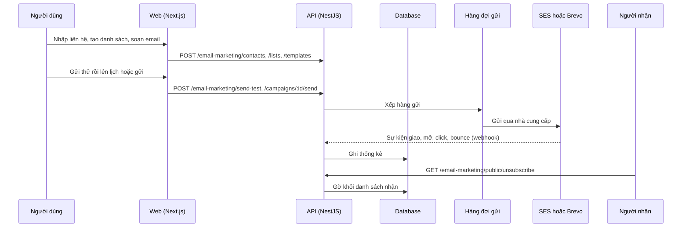

# F31: Email marketing

- **Nhóm:** G. Nhắn tin
- **Mức ưu tiên:** P1
- **Route giao diện:** `/email-marketing`
- **API chính:**
  - `POST /email-marketing/contacts/import-file`
  - `POST /email-marketing/lists`
  - `POST /email-marketing/segments`
  - `POST /email-marketing/templates`
  - `POST /email-marketing/send-test`
  - `POST /email-marketing/campaigns`
  - `POST /email-marketing/campaigns/:id/send`
  - `POST /email-marketing/campaigns/:id/schedule`
  - `GET /email-marketing/public/unsubscribe`
  - `POST /webhooks/brevo`

## Điều kiện trước khi test

- Cấu hình SES hoặc Brevo (môi trường thử)
- Danh sách liên hệ thử

## Sơ đồ sequence

## Các bước test

| # | Bước thực hiện | Kết quả mong đợi | Test tự động |
|---|---|---|---|
| 1 | Cấu hình SES | Đọc đúng cấu hình và quyền | `test-email-ses-config.ts` |
| 2 | Chạy kiểm tra P0 cho SES | Đạt | `test-email-ses-p0.ts` |
| 3 | Định tuyến SES và Brevo | Chọn đúng nhà cung cấp | `test-email-ses-brevo-router.cjs` |
| 4 | Logic email marketing | Danh sách, phân đoạn, mẫu đúng | `test-email-marketing.ts` |
| 5 | Hàng đợi gửi Brevo | Gửi đúng thứ tự | `test-brevo-queue-send.cjs` |
| 6 | Webhook Brevo | Cập nhật trạng thái đúng | `test-brevo-webhook-e2e.cjs` |
| 7 | Lên lịch chiến dịch | Gửi đúng giờ | `test-email-campaign-schedule-e2e.cjs` |
| 8 | Gửi thật (chỉ chạy chủ động) | Email đến hộp thư thử | `test-brevo-email-e2e-live.cjs` |
| 9 | Hủy đăng ký qua liên kết | Người nhận bị gỡ, không nhận lần sau | Thủ công |

## Trường hợp biên và lỗi cần thử

- Bounce và khiếu nại spam
- Tên miền gửi chưa xác thực
- Mã hóa nội dung có tiếng Việt

## Ghi chú

- Cột "Thủ công" nghĩa là chưa thấy test tự động tương ứng. Cần kiểm tra bằng tay hoặc viết test mới.
- Việc ghép test với bước dựa trên tên file, chưa mở đọc từng test. Chưa chạy lại để lấy baseline.
- Test có hậu tố `-live` hoặc `-e2e` gọi dịch vụ ngoài, chỉ chạy khi chủ động.
- Cách chạy và ma trận: `docs/test case/REGRESSION_MATRIX.md`.
