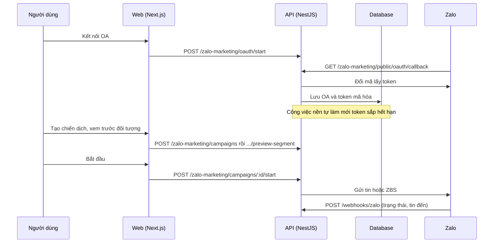

# F32: Zalo marketing (OA, ZBS, chiến dịch)

- **Nhóm:** G. Nhắn tin
- **Mức ưu tiên:** P1
- **Route giao diện:** `/zalo-marketing`
- **API chính:**
  - `POST /zalo-marketing/oauth/start`
  - `GET /zalo-marketing/public/oauth/callback`
  - `GET /zalo-marketing/oa`
  - `POST /zalo-marketing/oa/:id/refresh`
  - `POST /zalo-marketing/oa/:id/disconnect`
  - `POST /zalo-marketing/campaigns`
  - `POST /zalo-marketing/campaigns/:id/start`
  - `POST /webhooks/zalo`

## Điều kiện trước khi test

- Một Official Account (OA) thử
- Cấu hình ứng dụng Zalo

## Sơ đồ sequence

## Các bước test

| # | Bước thực hiện | Kết quả mong đợi | Test tự động |
|---|---|---|---|
| 1 | Backend OA | Lưu OA và token đúng | `test-zalo-oa-backend.cjs` |
| 2 | Tự làm mới token | Làm mới trước khi hết hạn | `test-zalo-oa-auto-refresh.cjs` |
| 3 | Ngắt kết nối OA | Token bị xóa, chiến dịch dừng | `test-zalo-oa-disconnect.cjs` |
| 4 | Kết nối lại chéo tổ chức | Không gán OA của tổ chức khác | `test-zalo-oa-cross-org-reconnect.cjs` |
| 5 | Chuyển hướng OAuth | Quay về đúng trang | `test-zalo-oa-oauth-redirect-e2e.cjs` |
| 6 | Chữ ký webhook | Từ chối webhook sai chữ ký | `test-zalo-webhook-signature.cjs` |
| 7 | Chiến dịch Zalo 3 chế độ | Đúng từng chế độ | `test-zalo-marketing-3modes-e2e.cjs` |
| 8 | Thử trên production (chủ động) | Đạt | `test-zalo-marketing-e2e-live.cjs` |

## Trường hợp biên và lỗi cần thử

- OA hết quyền gửi
- Giới hạn hạn mức tin ZBS
- Webhook đến trùng

## Ghi chú

- Cột "Thủ công" nghĩa là chưa thấy test tự động tương ứng. Cần kiểm tra bằng tay hoặc viết test mới.
- Việc ghép test với bước dựa trên tên file, chưa mở đọc từng test. Chưa chạy lại để lấy baseline.
- Test có hậu tố `-live` hoặc `-e2e` gọi dịch vụ ngoài, chỉ chạy khi chủ động.
- Cách chạy và ma trận: `docs/test case/REGRESSION_MATRIX.md`.
