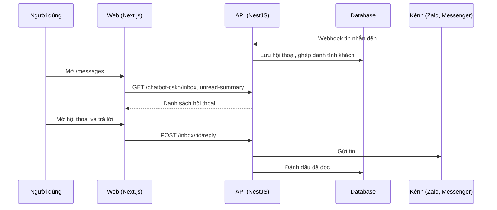

# F33: Hộp thư hợp nhất (messages)

- **Nhóm:** G. Nhắn tin
- **Mức ưu tiên:** P1
- **Route giao diện:** `/messages`
- **API chính:**
  - `GET /chatbot-cskh/inbox`
  - `GET /chatbot-cskh/inbox/:id`
  - `POST /chatbot-cskh/inbox/:id/reply`
  - `POST /chatbot-cskh/inbox/:id/read`
  - `POST /chatbot-cskh/zalo-oa/attach`
  - `GET /chatbot-cskh/inbox/unread-summary`

## Điều kiện trước khi test

- Có hội thoại từ nhiều kênh

## Sơ đồ sequence

## Các bước test

| # | Bước thực hiện | Kết quả mong đợi | Test tự động |
|---|---|---|---|
| 1 | Soạn và gửi tin | Tin gửi đúng kênh, hiện trong hội thoại | `test-messages-composer-e2e.cjs` |
| 2 | Hộp thư Zalo | Hiển thị và trả lời đúng | `zalo-cskh-inbox-e2e.cjs` |
| 3 | Số tin chưa đọc | Đúng và cập nhật sau khi đọc | Thủ công |
| 4 | Tiếp quản từ bot | Bot dừng, nhân viên trả lời | Thủ công |
| 5 | Tin đến từ khách chưa có hồ sơ | Tạo và ghép danh tính | `test-messaging-contact-identity.ts` |

## Trường hợp biên và lỗi cần thử

- Tin có ảnh, file, sticker
- Hai nhân viên cùng trả lời
- Hội thoại rất dài

## Ghi chú

- Cột "Thủ công" nghĩa là chưa thấy test tự động tương ứng. Cần kiểm tra bằng tay hoặc viết test mới.
- Việc ghép test với bước dựa trên tên file, chưa mở đọc từng test. Chưa chạy lại để lấy baseline.
- Test có hậu tố `-live` hoặc `-e2e` gọi dịch vụ ngoài, chỉ chạy khi chủ động.
- Cách chạy và ma trận: `docs/test case/REGRESSION_MATRIX.md`.
