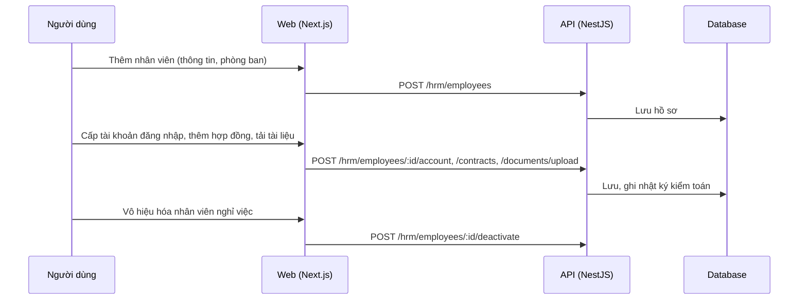

# F34: Quản lý nhân viên (hồ sơ, hợp đồng, tài khoản)

- **Nhóm:** H. Nhân sự
- **Mức ưu tiên:** P1
- **Route giao diện:** `/hrm/employees, /hrm/employees/[id]`
- **API chính:**
  - `GET /hrm/employees`
  - `POST /hrm/employees`
  - `PATCH /hrm/employees/:id`
  - `POST /hrm/employees/:id/deactivate`
  - `POST /hrm/employees/:id/account`
  - `POST /hrm/employees/:id/contracts`
  - `POST /hrm/employees/:id/documents/upload`

## Điều kiện trước khi test

- Tài khoản quản trị nhân sự
- Một phòng ban

## Sơ đồ sequence

## Các bước test

| # | Bước thực hiện | Kết quả mong đợi | Test tự động |
|---|---|---|---|
| 1 | Thêm và sửa hồ sơ nhân viên | Lưu và hiển thị đúng | Thủ công |
| 2 | Cấp tài khoản và đặt lại mật khẩu | Đăng nhập được, quyền đúng | Thủ công |
| 3 | Thêm hợp đồng và tải tài liệu | Lưu, tải về đúng | Thủ công |
| 4 | Vô hiệu hóa nhân viên | Không đăng nhập được, dữ liệu lịch sử giữ lại | Thủ công |
| 5 | Nhân viên chỉ thấy dữ liệu của mình | Đúng phân quyền | `test-work-management-rbac.ts` |
| 6 | Xem nhật ký thay đổi | Có đủ thao tác | Thủ công |

## Trường hợp biên và lỗi cần thử

- Email nhân viên trùng
- Tài liệu quá lớn hoặc sai định dạng

## Ghi chú

- Cột "Thủ công" nghĩa là chưa thấy test tự động tương ứng. Cần kiểm tra bằng tay hoặc viết test mới.
- Việc ghép test với bước dựa trên tên file, chưa mở đọc từng test. Chưa chạy lại để lấy baseline.
- Test có hậu tố `-live` hoặc `-e2e` gọi dịch vụ ngoài, chỉ chạy khi chủ động.
- Cách chạy và ma trận: `docs/test case/REGRESSION_MATRIX.md`.
