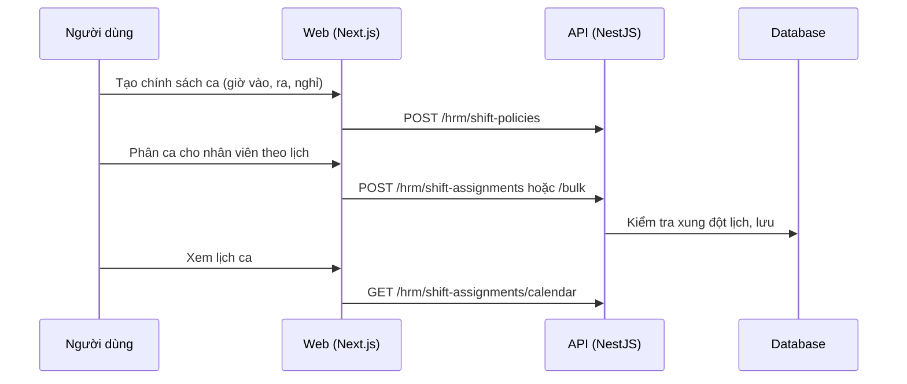

# F35: Ca làm việc và phân ca

- **Nhóm:** H. Nhân sự
- **Mức ưu tiên:** P1
- **Route giao diện:** `/hrm/shifts`
- **API chính:**
  - `GET /hrm/shift-policies`
  - `POST /hrm/shift-policies`
  - `GET /hrm/shift-assignments/calendar`
  - `POST /hrm/shift-assignments`
  - `POST /hrm/shift-assignments/bulk`
  - `PATCH /hrm/shift-assignments/:id`

## Điều kiện trước khi test

- Có nhân viên và chính sách ca

## Sơ đồ sequence

## Các bước test

| # | Bước thực hiện | Kết quả mong đợi | Test tự động |
|---|---|---|---|
| 1 | Tạo, bật và tắt chính sách ca | Trạng thái đúng | `test-hrm-shifts.ts` |
| 2 | Phân ca đơn lẻ và hàng loạt | Đúng người, đúng ngày | `test-hrm-shifts.ts` |
| 3 | Phát hiện xung đột ca | Bị chặn hoặc cảnh báo | `test-hrm-shifts.ts` |
| 4 | Xem lịch ca theo tuần | Hiển thị đúng | Thủ công |
| 5 | Xóa phân ca đã chấm công | Bị chặn hoặc xử lý đúng | Thủ công |

## Trường hợp biên và lỗi cần thử

- Ca qua nửa đêm
- Phân ca cho nhân viên đã nghỉ

## Ghi chú

- Cột "Thủ công" nghĩa là chưa thấy test tự động tương ứng. Cần kiểm tra bằng tay hoặc viết test mới.
- Việc ghép test với bước dựa trên tên file, chưa mở đọc từng test. Chưa chạy lại để lấy baseline.
- Test có hậu tố `-live` hoặc `-e2e` gọi dịch vụ ngoài, chỉ chạy khi chủ động.
- Cách chạy và ma trận: `docs/test case/REGRESSION_MATRIX.md`.
