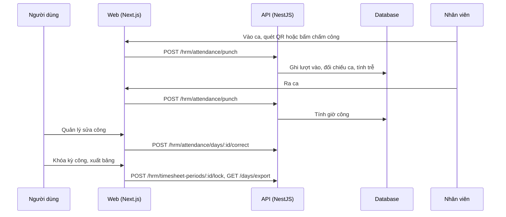

# F36: Chấm công

- **Nhóm:** H. Nhân sự
- **Mức ưu tiên:** P1
- **Route giao diện:** `/hrm/attendance`
- **API chính:**
  - `GET /hrm/attendance/today`
  - `POST /hrm/attendance/punch`
  - `GET /hrm/attendance/days`
  - `POST /hrm/attendance/days/:id/correct`
  - `POST /hrm/attendance/adjustments`
  - `GET /hrm/attendance/qr-tokens`
  - `GET /hrm/attendance/days/export`
  - `POST /hrm/timesheet-periods/:id/lock`

## Điều kiện trước khi test

- Nhân viên có ca hôm nay
- Mã QR chấm công (nếu dùng)

## Sơ đồ sequence

## Các bước test

| # | Bước thực hiện | Kết quả mong đợi | Test tự động |
|---|---|---|---|
| 1 | Chấm vào ra | Ghi đúng, tính giờ công đúng | `test-hrm-attendance.ts` |
| 2 | Chấm công trễ, sớm, quên chấm ra | Tính đúng quy tắc | `test-hrm-attendance.ts` |
| 3 | Quản lý sửa công | Có ghi nhật ký, có lý do | `test-hrm-attendance.ts` |
| 4 | Khóa kỳ công rồi thử sửa | Bị chặn | Thủ công |
| 5 | Xuất bảng chấm công | Số liệu khớp màn hình | Thủ công |
| 6 | Mã QR hết hạn | Không chấm được | Thủ công |

## Trường hợp biên và lỗi cần thử

- Chấm công ngoài ca
- Hai lần chấm liên tiếp
- Múi giờ

## Ghi chú

- Cột "Thủ công" nghĩa là chưa thấy test tự động tương ứng. Cần kiểm tra bằng tay hoặc viết test mới.
- Việc ghép test với bước dựa trên tên file, chưa mở đọc từng test. Chưa chạy lại để lấy baseline.
- Test có hậu tố `-live` hoặc `-e2e` gọi dịch vụ ngoài, chỉ chạy khi chủ động.
- Cách chạy và ma trận: `docs/test case/REGRESSION_MATRIX.md`.
