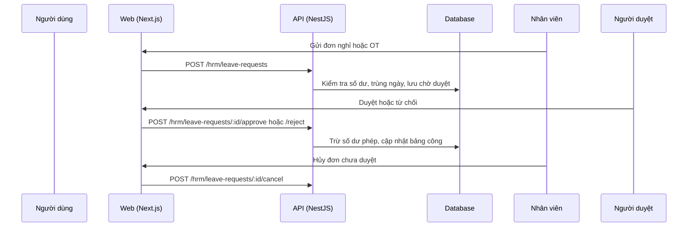

# F37: Nghỉ phép và làm thêm giờ (OT)

- **Nhóm:** H. Nhân sự
- **Mức ưu tiên:** P1
- **Route giao diện:** `/hrm/leave`
- **API chính:**
  - `GET /hrm/leave-requests`
  - `GET /hrm/leave-requests/balance`
  - `POST /hrm/leave-requests`
  - `POST /hrm/leave-requests/:id/approve`
  - `POST /hrm/leave-requests/:id/reject`
  - `POST /hrm/leave-requests/:id/cancel`

## Điều kiện trước khi test

- Nhân viên có số dư phép
- Người duyệt

## Sơ đồ sequence

## Các bước test

| # | Bước thực hiện | Kết quả mong đợi | Test tự động |
|---|---|---|---|
| 1 | Gửi đơn nghỉ và xem số dư | Số dư đúng | `test-hrm-leave.ts` |
| 2 | Duyệt và từ chối | Số dư và công đổi đúng | `test-hrm-leave.ts` |
| 3 | Hủy đơn | Hoàn lại số dư nếu đã trừ | `test-hrm-leave.ts` |
| 4 | Gửi đơn vượt số dư | Bị chặn | Thủ công |
| 5 | Gửi đơn trùng ngày | Bị chặn | Thủ công |
| 6 | Đính kèm file | Tải được | Thủ công |

## Trường hợp biên và lỗi cần thử

- Nghỉ nửa ngày
- Nghỉ qua tháng hoặc qua kỳ công
- Người duyệt tự duyệt đơn của mình

## Ghi chú

- Cột "Thủ công" nghĩa là chưa thấy test tự động tương ứng. Cần kiểm tra bằng tay hoặc viết test mới.
- Việc ghép test với bước dựa trên tên file, chưa mở đọc từng test. Chưa chạy lại để lấy baseline.
- Test có hậu tố `-live` hoặc `-e2e` gọi dịch vụ ngoài, chỉ chạy khi chủ động.
- Cách chạy và ma trận: `docs/test case/REGRESSION_MATRIX.md`.
