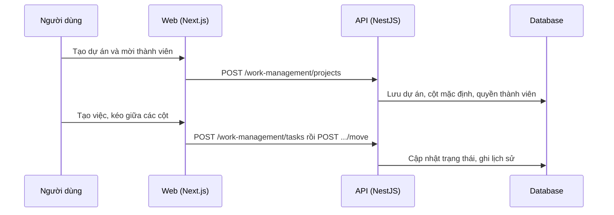

# F38: Dự án và bảng công việc

- **Nhóm:** I. Quản lý công việc
- **Mức ưu tiên:** P1
- **Route giao diện:** `/work-management`
- **API chính:**
  - `GET /work-management/projects`
  - `POST /work-management/projects`
  - `PATCH /work-management/projects/:id`
  - `POST /work-management/tasks`
  - `POST /work-management/tasks/:id/move`
  - `PATCH /work-management/columns/:id`

## Điều kiện trước khi test

- Hai người dùng với vai trò khác nhau

## Sơ đồ sequence

## Các bước test

| # | Bước thực hiện | Kết quả mong đợi | Test tự động |
|---|---|---|---|
| 1 | Phân quyền dự án | Chỉ thành viên đúng quyền thao tác | `test-work-management-rbac.ts` |
| 2 | Cộng tác nhiều người | Cập nhật không ghi đè nhau | `test-work-management-collab.ts` |
| 3 | Ma trận đầy đủ các thao tác | Đúng theo vai trò | `test-work-management-full-matrix.ts` |
| 4 | Kéo việc giữa cột | Trạng thái và lịch sử đúng | Thủ công |
| 5 | Lưu trữ và khôi phục việc | Đúng | Thủ công |
| 6 | Tài liệu của dự án | Tải lên và tải xuống đúng | Thủ công |

## Trường hợp biên và lỗi cần thử

- Hai người kéo cùng một việc
- Xóa dự án có việc
- Thành viên bị gỡ quyền

## Ghi chú

- Cột "Thủ công" nghĩa là chưa thấy test tự động tương ứng. Cần kiểm tra bằng tay hoặc viết test mới.
- Việc ghép test với bước dựa trên tên file, chưa mở đọc từng test. Chưa chạy lại để lấy baseline.
- Test có hậu tố `-live` hoặc `-e2e` gọi dịch vụ ngoài, chỉ chạy khi chủ động.
- Cách chạy và ma trận: `docs/test case/REGRESSION_MATRIX.md`.
