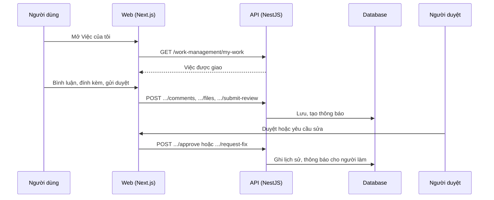

# F39: Việc của tôi, chi tiết việc, bình luận

- **Nhóm:** I. Quản lý công việc
- **Mức ưu tiên:** P1
- **Route giao diện:** `/work-management/my`
- **API chính:**
  - `GET /work-management/my-work`
  - `GET /work-management/tasks/:id`
  - `POST /work-management/tasks/:id/comments`
  - `POST /work-management/tasks/:id/files`
  - `POST /work-management/tasks/:id/submit-review`
  - `POST /work-management/tasks/:id/approve`
  - `POST /work-management/tasks/:id/request-fix`
  - `GET /work-management/notifications`

## Điều kiện trước khi test

- Người dùng được giao một số việc

## Sơ đồ sequence

## Các bước test

| # | Bước thực hiện | Kết quả mong đợi | Test tự động |
|---|---|---|---|
| 1 | Chi tiết việc, bình luận | Hiển thị và lưu đúng | `test-work-task-detail.ts` |
| 2 | Quy trình gửi duyệt, duyệt, yêu cầu sửa | Trạng thái và lịch sử đúng | `test-work-management-full-matrix.ts` |
| 3 | Thông báo | Đến đúng người, đánh dấu đã đọc được | Thủ công |
| 4 | Đính kèm file | Tải lên, tải xuống đúng quyền | Thủ công |
| 5 | Việc không phải của mình | Không sửa được nếu không có quyền | `test-work-management-rbac.ts` |

## Trường hợp biên và lỗi cần thử

- Bình luận chứa mã độc
- File lớn
- Việc bị xóa khi đang mở

## Ghi chú

- Cột "Thủ công" nghĩa là chưa thấy test tự động tương ứng. Cần kiểm tra bằng tay hoặc viết test mới.
- Việc ghép test với bước dựa trên tên file, chưa mở đọc từng test. Chưa chạy lại để lấy baseline.
- Test có hậu tố `-live` hoặc `-e2e` gọi dịch vụ ngoài, chỉ chạy khi chủ động.
- Cách chạy và ma trận: `docs/test case/REGRESSION_MATRIX.md`.
