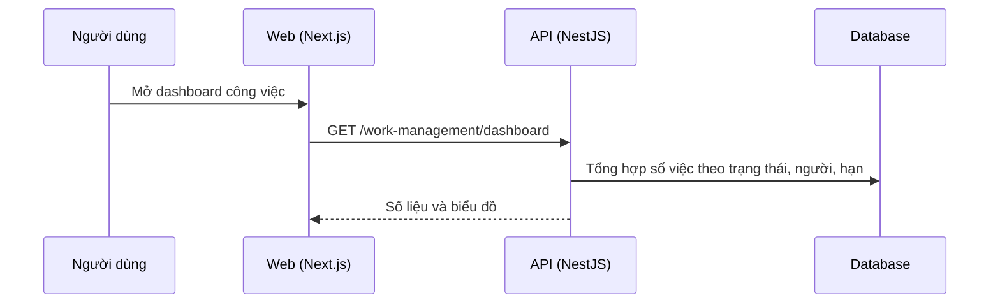

# F40: Dashboard công việc

- **Nhóm:** I. Quản lý công việc
- **Mức ưu tiên:** P2
- **Route giao diện:** `/work-management/dashboard`
- **API chính:**
  - `GET /work-management/dashboard`

## Điều kiện trước khi test

- Dữ liệu việc ở nhiều trạng thái

## Sơ đồ sequence

## Các bước test

| # | Bước thực hiện | Kết quả mong đợi | Test tự động |
|---|---|---|---|
| 1 | Số liệu tổng hợp và phân tích | Khớp dữ liệu việc | `test-work-management-insights.ts` |
| 2 | Lọc theo dự án và người | Số liệu đổi đúng | Thủ công |
| 3 | Việc quá hạn | Được đếm và nêu rõ | Thủ công |

## Trường hợp biên và lỗi cần thử

- Không có dữ liệu
- Nhiều dự án

## Ghi chú

- Cột "Thủ công" nghĩa là chưa thấy test tự động tương ứng. Cần kiểm tra bằng tay hoặc viết test mới.
- Việc ghép test với bước dựa trên tên file, chưa mở đọc từng test. Chưa chạy lại để lấy baseline.
- Test có hậu tố `-live` hoặc `-e2e` gọi dịch vụ ngoài, chỉ chạy khi chủ động.
- Cách chạy và ma trận: `docs/test case/REGRESSION_MATRIX.md`.
