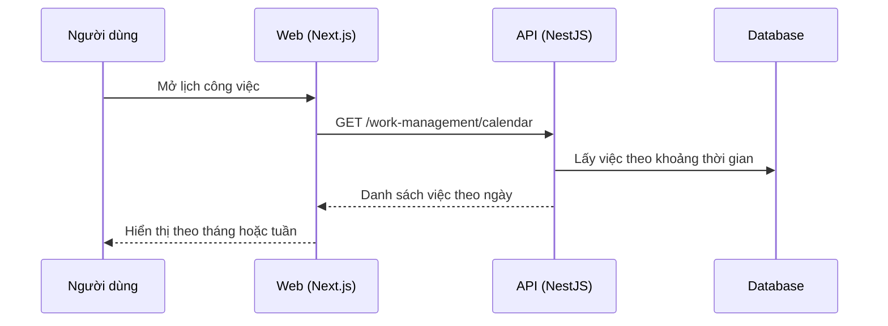

# F41: Lịch công việc

- **Nhóm:** I. Quản lý công việc
- **Mức ưu tiên:** P2
- **Route giao diện:** `/work-management/calendar`
- **API chính:**
  - `GET /work-management/calendar`

## Điều kiện trước khi test

- Việc có ngày bắt đầu và hạn

## Sơ đồ sequence

## Các bước test

| # | Bước thực hiện | Kết quả mong đợi | Test tự động |
|---|---|---|---|
| 1 | Hiển thị việc theo ngày | Đúng ngày, đúng màu trạng thái | Thủ công |
| 2 | Chuyển tháng, tuần | Dữ liệu đúng | Thủ công |
| 3 | Bấm một việc | Mở đúng chi tiết | Thủ công |
| 4 | Việc nhiều ngày | Kéo dài đúng | Thủ công |

## Trường hợp biên và lỗi cần thử

- Việc không có hạn
- Múi giờ

## Ghi chú

- Cột "Thủ công" nghĩa là chưa thấy test tự động tương ứng. Cần kiểm tra bằng tay hoặc viết test mới.
- Việc ghép test với bước dựa trên tên file, chưa mở đọc từng test. Chưa chạy lại để lấy baseline.
- Test có hậu tố `-live` hoặc `-e2e` gọi dịch vụ ngoài, chỉ chạy khi chủ động.
- Cách chạy và ma trận: `docs/test case/REGRESSION_MATRIX.md`.
