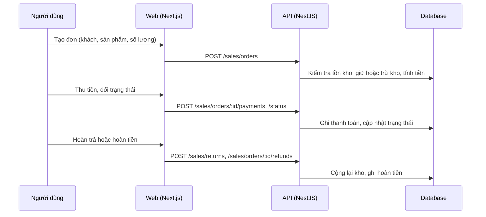

# F42: Đơn hàng bán

- **Nhóm:** J. Bán hàng
- **Mức ưu tiên:** P0
- **Route giao diện:** `/sales/orders`
- **API chính:**
  - `GET /sales/orders`
  - `POST /sales/orders`
  - `POST /sales/orders/:id/status`
  - `POST /sales/orders/:id/payments`
  - `POST /sales/orders/:id/refunds`
  - `POST /sales/returns`
  - `POST /sales/orders/:id/export`

## Điều kiện trước khi test

- Sản phẩm có tồn kho
- Khách hàng thử

## Sơ đồ sequence

## Các bước test

| # | Bước thực hiện | Kết quả mong đợi | Test tự động |
|---|---|---|---|
| 1 | Tạo đơn đủ hàng | Tính tiền đúng, tồn kho đổi đúng | `test-sales-inventory-harden-e2e.ts` |
| 2 | Tạo đơn vượt tồn kho | Bị chặn hoặc cảnh báo | `test-sales-inventory-harden-e2e.ts` |
| 3 | Thu tiền một phần và đủ | Công nợ đúng | Thủ công |
| 4 | Đổi trạng thái đơn | Chuyển hợp lệ, có lịch sử | Thủ công |
| 5 | Hủy đơn và hoàn trả hàng | Kho và tiền về đúng | Thủ công |
| 6 | Xuất đơn | File đúng nội dung | Thủ công |

## Trường hợp biên và lỗi cần thử

- Hai đơn cùng mua món cuối cùng
- Giảm giá và thuế
- Làm tròn tiền

## Ghi chú

- Cột "Thủ công" nghĩa là chưa thấy test tự động tương ứng. Cần kiểm tra bằng tay hoặc viết test mới.
- Việc ghép test với bước dựa trên tên file, chưa mở đọc từng test. Chưa chạy lại để lấy baseline.
- Test có hậu tố `-live` hoặc `-e2e` gọi dịch vụ ngoài, chỉ chạy khi chủ động.
- Cách chạy và ma trận: `docs/test case/REGRESSION_MATRIX.md`.
