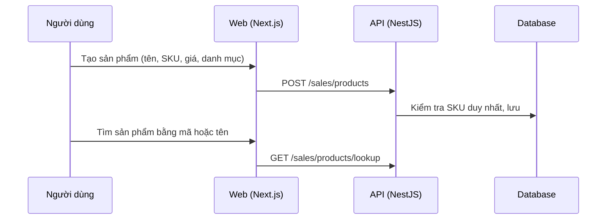

# F43: Sản phẩm và danh mục

- **Nhóm:** J. Bán hàng
- **Mức ưu tiên:** P1
- **Route giao diện:** `/sales/products`
- **API chính:**
  - `GET /sales/products`
  - `POST /sales/products`
  - `PATCH /sales/products/:id`
  - `GET /sales/products/lookup`
  - `GET /sales/categories`
  - `POST /sales/categories`
  - `GET /sales/suppliers`

## Điều kiện trước khi test

- Danh mục thử

## Sơ đồ sequence

## Các bước test

| # | Bước thực hiện | Kết quả mong đợi | Test tự động |
|---|---|---|---|
| 1 | Tạo, sửa sản phẩm | Lưu đúng | Thủ công |
| 2 | SKU trùng | Bị chặn | Thủ công |
| 3 | Tìm bằng mã vạch hoặc tên | Ra đúng sản phẩm | Thủ công |
| 4 | Đổi giá | Không ảnh hưởng đơn cũ | Thủ công |
| 5 | Ngừng bán | Không còn trong lựa chọn khi tạo đơn | Thủ công |

## Trường hợp biên và lỗi cần thử

- Giá âm
- Sản phẩm có lô và hạn dùng

## Ghi chú

- Cột "Thủ công" nghĩa là chưa thấy test tự động tương ứng. Cần kiểm tra bằng tay hoặc viết test mới.
- Việc ghép test với bước dựa trên tên file, chưa mở đọc từng test. Chưa chạy lại để lấy baseline.
- Test có hậu tố `-live` hoặc `-e2e` gọi dịch vụ ngoài, chỉ chạy khi chủ động.
- Cách chạy và ma trận: `docs/test case/REGRESSION_MATRIX.md`.
