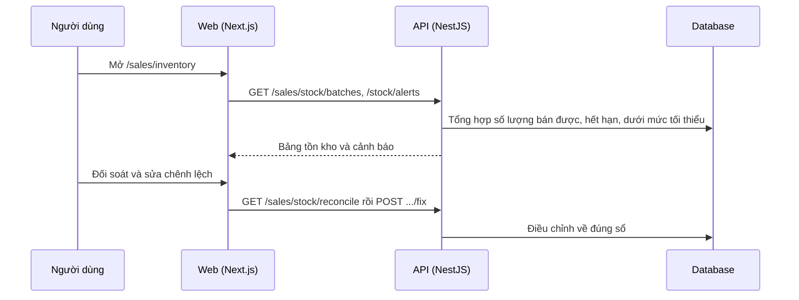

# F44: Tồn kho (số lượng, lô, hạn dùng, cảnh báo)

- **Nhóm:** J. Bán hàng
- **Mức ưu tiên:** P0
- **Route giao diện:** `/sales/inventory`
- **API chính:**
  - `GET /sales/stock/batches`
  - `GET /sales/stock/alerts`
  - `GET /sales/stock/reconcile`
  - `POST /sales/stock/reconcile/fix`

## Điều kiện trước khi test

- Sản phẩm có nhiều lô, có lô hết hạn

## Sơ đồ sequence

## Các bước test

| # | Bước thực hiện | Kết quả mong đợi | Test tự động |
|---|---|---|---|
| 1 | Số lượng bán được và số lượng hết hạn | Đúng, không tính hàng hết hạn là bán được | `test-sales-inventory-harden-e2e.ts` |
| 2 | Cảnh báo dưới mức tối thiểu | Hiện đúng sản phẩm | Thủ công |
| 3 | Đối soát tồn kho và sổ | Chênh lệch được liệt kê | Thủ công |
| 4 | Sửa chênh lệch | Về đúng và có nhật ký | Thủ công |
| 5 | Bán theo thứ tự lô (hết hạn trước) | Đúng quy tắc | Thủ công |

## Trường hợp biên và lỗi cần thử

- Tồn âm
- Lô trùng mã
- Hai thao tác cùng lúc trên một lô

## Ghi chú

- Cột "Thủ công" nghĩa là chưa thấy test tự động tương ứng. Cần kiểm tra bằng tay hoặc viết test mới.
- Việc ghép test với bước dựa trên tên file, chưa mở đọc từng test. Chưa chạy lại để lấy baseline.
- Test có hậu tố `-live` hoặc `-e2e` gọi dịch vụ ngoài, chỉ chạy khi chủ động.
- Cách chạy và ma trận: `docs/test case/REGRESSION_MATRIX.md`.
