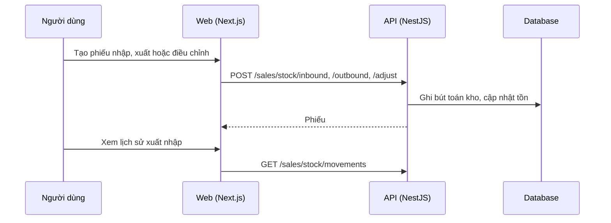

# F45: Nhập, xuất, điều chỉnh kho

- **Nhóm:** J. Bán hàng
- **Mức ưu tiên:** P0
- **Route giao diện:** `/sales/stock-movements`
- **API chính:**
  - `GET /sales/stock/movements`
  - `POST /sales/stock/inbound`
  - `POST /sales/stock/outbound`
  - `POST /sales/stock/adjust`

## Điều kiện trước khi test

- Sản phẩm thử

## Sơ đồ sequence

## Các bước test

| # | Bước thực hiện | Kết quả mong đợi | Test tự động |
|---|---|---|---|
| 1 | Nhập kho | Tồn tăng đúng, có lô | `test-sales-inventory-harden-e2e.ts` |
| 2 | Xuất kho vượt tồn | Bị chặn | Thủ công |
| 3 | Điều chỉnh kho có lý do | Ghi nhật ký | Thủ công |
| 4 | Lịch sử xuất nhập | Khớp với tồn | Thủ công |
| 5 | Hủy hoặc đảo phiếu | Tồn quay về đúng | Thủ công |

## Trường hợp biên và lỗi cần thử

- Số lượng thập phân
- Phiếu trùng

## Ghi chú

- Cột "Thủ công" nghĩa là chưa thấy test tự động tương ứng. Cần kiểm tra bằng tay hoặc viết test mới.
- Việc ghép test với bước dựa trên tên file, chưa mở đọc từng test. Chưa chạy lại để lấy baseline.
- Test có hậu tố `-live` hoặc `-e2e` gọi dịch vụ ngoài, chỉ chạy khi chủ động.
- Cách chạy và ma trận: `docs/test case/REGRESSION_MATRIX.md`.
