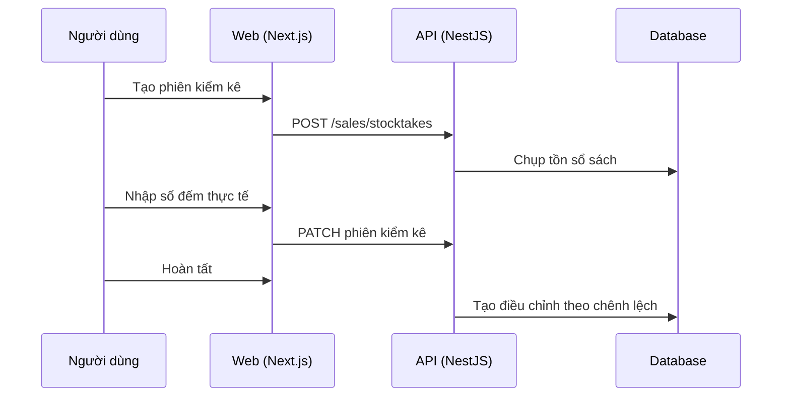

# F46: Kiểm kê kho

- **Nhóm:** J. Bán hàng
- **Mức ưu tiên:** P1
- **Route giao diện:** `/sales/stocktake`
- **API chính:**
  - `GET /sales/stocktakes`
  - `POST /sales/stocktakes`
  - `GET /sales/stocktakes/:id`

## Điều kiện trước khi test

- Có tồn kho ghi sổ

## Sơ đồ sequence

## Các bước test

| # | Bước thực hiện | Kết quả mong đợi | Test tự động |
|---|---|---|---|
| 1 | Tạo phiên và nhập số thực tế | Chênh lệch tính đúng | Thủ công |
| 2 | Hoàn tất kiểm kê | Tạo điều chỉnh kho đúng | Thủ công |
| 3 | Phát sinh bán hàng trong lúc kiểm kê | Xử lý đúng | Thủ công |
| 4 | Xem phiên cũ | Giữ nguyên số liệu | Thủ công |

## Trường hợp biên và lỗi cần thử

- Kiểm kê một phần kho
- Hai người cùng nhập

## Ghi chú

- Cột "Thủ công" nghĩa là chưa thấy test tự động tương ứng. Cần kiểm tra bằng tay hoặc viết test mới.
- Việc ghép test với bước dựa trên tên file, chưa mở đọc từng test. Chưa chạy lại để lấy baseline.
- Test có hậu tố `-live` hoặc `-e2e` gọi dịch vụ ngoài, chỉ chạy khi chủ động.
- Cách chạy và ma trận: `docs/test case/REGRESSION_MATRIX.md`.
