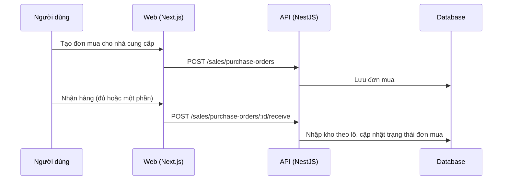

# F47: Mua hàng (đơn mua, nhận hàng)

- **Nhóm:** J. Bán hàng
- **Mức ưu tiên:** P1
- **Route giao diện:** `/sales/purchases`
- **API chính:**
  - `GET /sales/purchase-orders`
  - `POST /sales/purchase-orders`
  - `POST /sales/purchase-orders/:id/receive`
  - `GET /sales/suppliers`
  - `POST /sales/suppliers`

## Điều kiện trước khi test

- Nhà cung cấp và sản phẩm

## Sơ đồ sequence

## Các bước test

| # | Bước thực hiện | Kết quả mong đợi | Test tự động |
|---|---|---|---|
| 1 | Tạo đơn mua | Lưu đúng | Thủ công |
| 2 | Nhận đủ hàng | Kho tăng, đơn hoàn tất | Thủ công |
| 3 | Nhận một phần | Trạng thái một phần, phần còn lại đúng | Thủ công |
| 4 | Nhận vượt số đặt | Bị chặn hoặc cảnh báo | Thủ công |
| 5 | Giá vốn sau nhập | Cập nhật đúng | Thủ công |

## Trường hợp biên và lỗi cần thử

- Nhận hàng hai lần cùng một đơn
- Nhà cung cấp bị ngừng

## Ghi chú

- Cột "Thủ công" nghĩa là chưa thấy test tự động tương ứng. Cần kiểm tra bằng tay hoặc viết test mới.
- Việc ghép test với bước dựa trên tên file, chưa mở đọc từng test. Chưa chạy lại để lấy baseline.
- Test có hậu tố `-live` hoặc `-e2e` gọi dịch vụ ngoài, chỉ chạy khi chủ động.
- Cách chạy và ma trận: `docs/test case/REGRESSION_MATRIX.md`.
