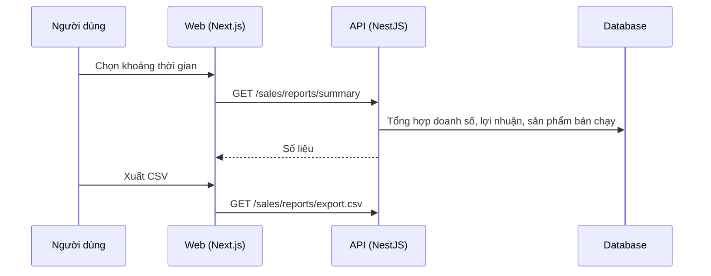

# F48: Báo cáo bán hàng

- **Nhóm:** J. Bán hàng
- **Mức ưu tiên:** P1
- **Route giao diện:** `/sales/reports`
- **API chính:**
  - `GET /sales/reports/summary`
  - `GET /sales/reports/export.csv`

## Điều kiện trước khi test

- Có đơn hàng ở nhiều ngày

## Sơ đồ sequence

## Các bước test

| # | Bước thực hiện | Kết quả mong đợi | Test tự động |
|---|---|---|---|
| 1 | Tổng hợp theo ngày, tuần, tháng | Khớp với tổng đơn | Thủ công |
| 2 | Đơn hủy và hoàn trả | Không tính vào doanh số | Thủ công |
| 3 | Xuất CSV | Số liệu và mã hóa tiếng Việt đúng | Thủ công |
| 4 | Lợi nhuận | Giá vốn đúng | Thủ công |

## Trường hợp biên và lỗi cần thử

- Khoảng thời gian rỗng
- Múi giờ cuối ngày

## Ghi chú

- Cột "Thủ công" nghĩa là chưa thấy test tự động tương ứng. Cần kiểm tra bằng tay hoặc viết test mới.
- Việc ghép test với bước dựa trên tên file, chưa mở đọc từng test. Chưa chạy lại để lấy baseline.
- Test có hậu tố `-live` hoặc `-e2e` gọi dịch vụ ngoài, chỉ chạy khi chủ động.
- Cách chạy và ma trận: `docs/test case/REGRESSION_MATRIX.md`.
