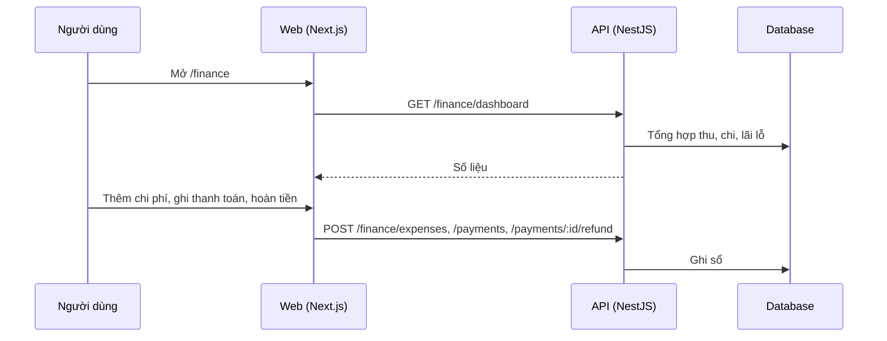

# F49: Doanh thu, chi phí và lãi lỗ (P&L)

- **Nhóm:** K. Tài chính
- **Mức ưu tiên:** P1
- **Route giao diện:** `/finance`
- **API chính:**
  - `GET /finance/dashboard`
  - `GET /finance/orders`
  - `POST /finance/orders`
  - `GET /finance/payments`
  - `POST /finance/payments`
  - `POST /finance/payments/:id/refund`
  - `GET /finance/expenses`
  - `POST /finance/expenses`

## Điều kiện trước khi test

- Đơn, thanh toán và chi phí thử

## Sơ đồ sequence

## Các bước test

| # | Bước thực hiện | Kết quả mong đợi | Test tự động |
|---|---|---|---|
| 1 | Tổng hợp thu chi | Lãi lỗ đúng | Thủ công |
| 2 | Thêm, sửa, xóa chi phí | Số liệu đổi đúng | Thủ công |
| 3 | Ghi thanh toán và hoàn tiền | Số dư đơn đúng | Thủ công |
| 4 | Hủy đơn | Doanh thu điều chỉnh | Thủ công |
| 5 | Phân quyền xem tài chính | Chỉ người có quyền thấy | `test-p0-security.ts` |

## Trường hợp biên và lỗi cần thử

- Chênh lệch làm tròn
- Khoản chi định kỳ

## Ghi chú

- Cột "Thủ công" nghĩa là chưa thấy test tự động tương ứng. Cần kiểm tra bằng tay hoặc viết test mới.
- Việc ghép test với bước dựa trên tên file, chưa mở đọc từng test. Chưa chạy lại để lấy baseline.
- Test có hậu tố `-live` hoặc `-e2e` gọi dịch vụ ngoài, chỉ chạy khi chủ động.
- Cách chạy và ma trận: `docs/test case/REGRESSION_MATRIX.md`.
