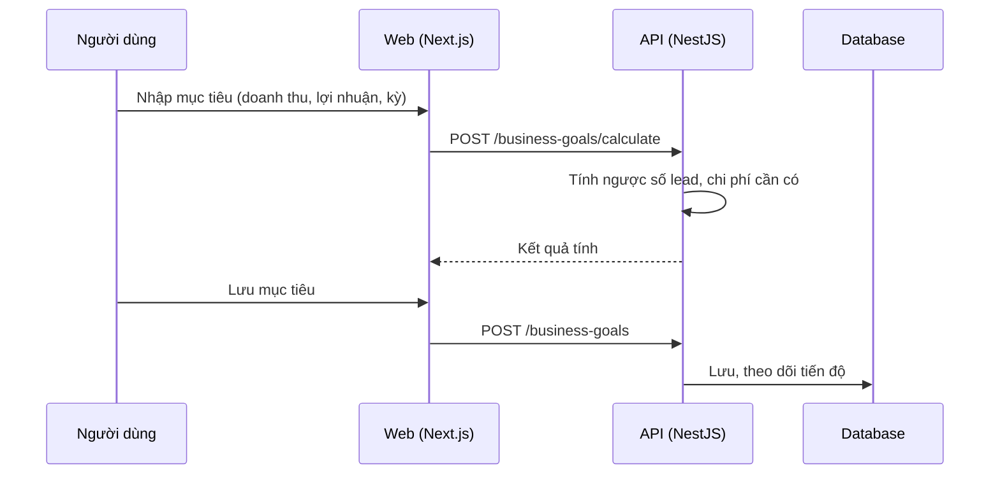

# F50: Mục tiêu kinh doanh

- **Nhóm:** K. Tài chính
- **Mức ưu tiên:** P2
- **Route giao diện:** `/business-goals`
- **API chính:**
  - `GET /business-goals`
  - `POST /business-goals/calculate`
  - `POST /business-goals`
  - `GET /business-goals/:id`
  - `DELETE /business-goals/:id`

## Điều kiện trước khi test

- Dữ liệu doanh thu và lead để đối chiếu

## Sơ đồ sequence

## Các bước test

| # | Bước thực hiện | Kết quả mong đợi | Test tự động |
|---|---|---|---|
| 1 | Tính chỉ số mục tiêu | Công thức đúng | `test-business-goal-metrics.ts` |
| 2 | Lưu và xem tiến độ | Số liệu đối chiếu đúng | Thủ công |
| 3 | Xóa mục tiêu | Không ảnh hưởng dữ liệu gốc | Thủ công |
| 4 | Mục tiêu bất hợp lý (âm, bằng 0) | Báo lỗi | Thủ công |

## Trường hợp biên và lỗi cần thử

- Chu kỳ đổi giữa chừng
- Dữ liệu thực tế chưa có

## Ghi chú

- Cột "Thủ công" nghĩa là chưa thấy test tự động tương ứng. Cần kiểm tra bằng tay hoặc viết test mới.
- Việc ghép test với bước dựa trên tên file, chưa mở đọc từng test. Chưa chạy lại để lấy baseline.
- Test có hậu tố `-live` hoặc `-e2e` gọi dịch vụ ngoài, chỉ chạy khi chủ động.
- Cách chạy và ma trận: `docs/test case/REGRESSION_MATRIX.md`.
